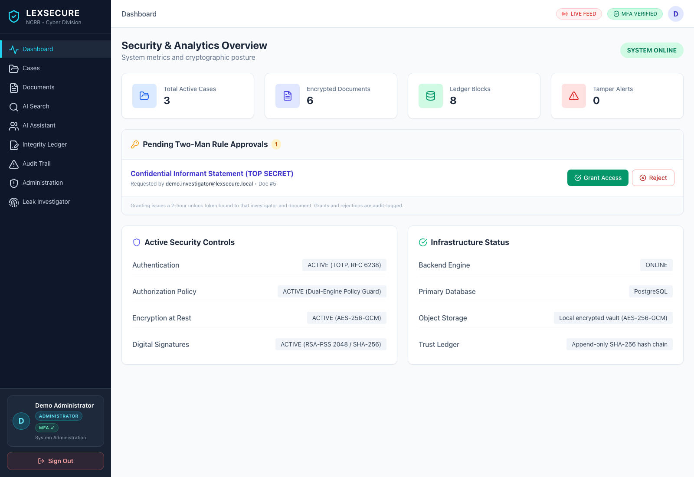
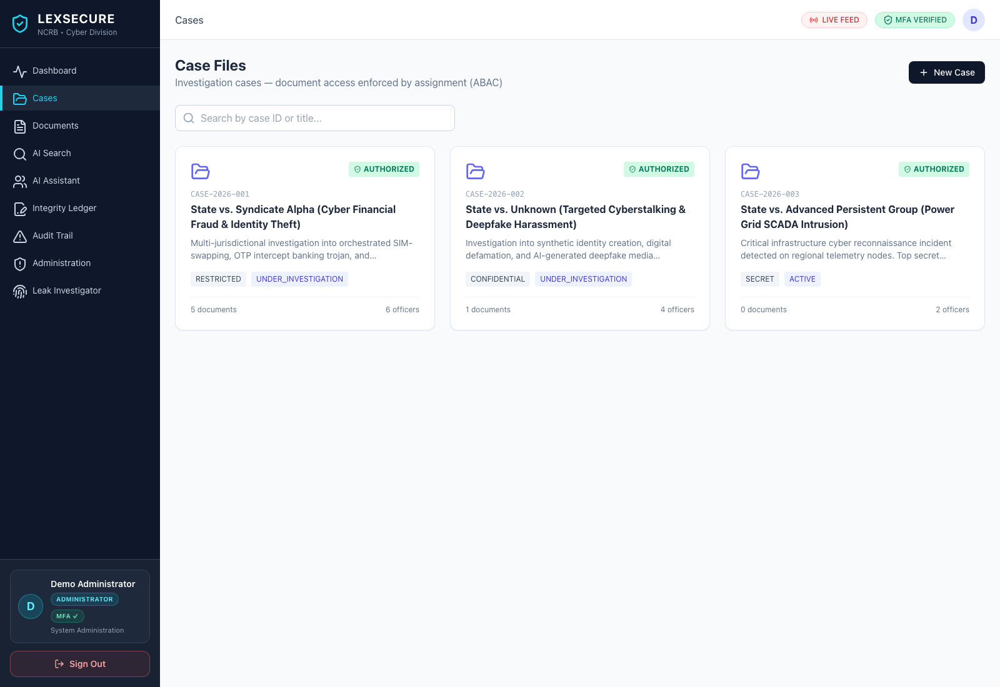
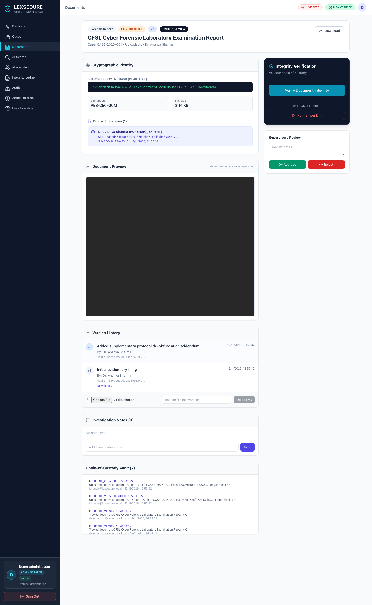
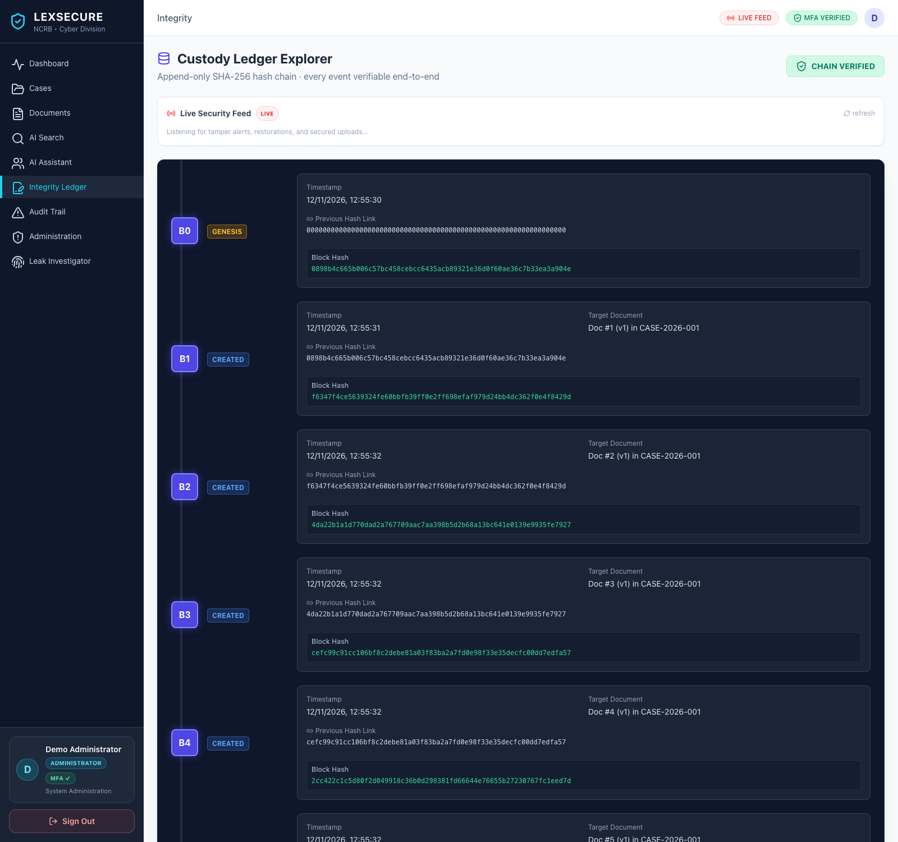
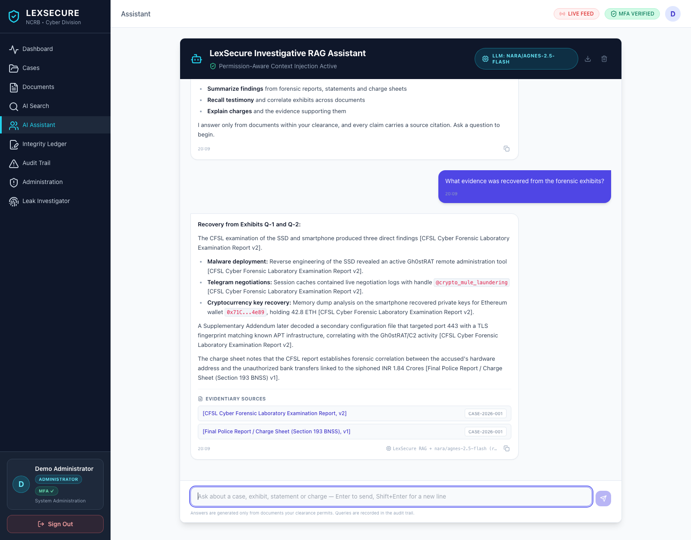
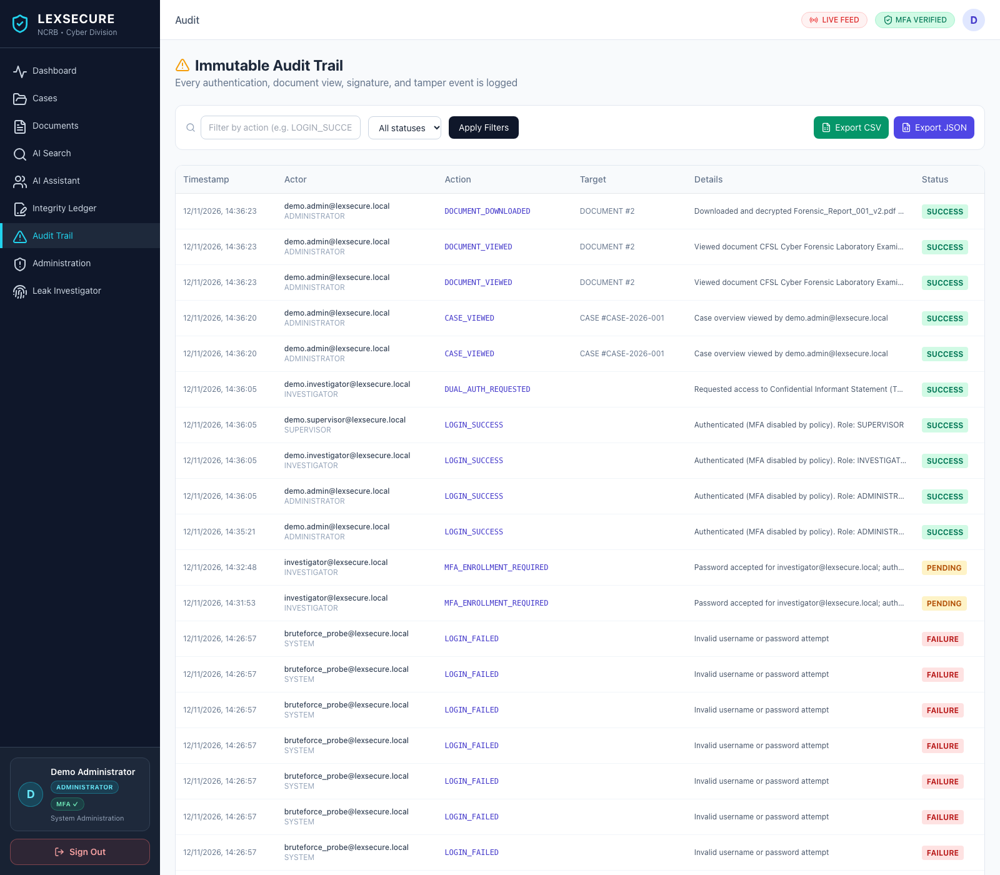
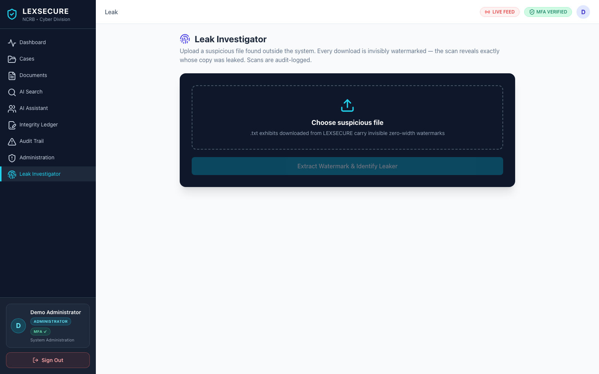

<div align="center">

# LEXSECURE

**Secure digital document management for investigative teams.**

*Tamper-evident evidence custody, attribute-based access control, and a
permission-aware AI assistant — in one deployable stack.*

[](https://github.com/lexsecure/lexsecure/actions/workflows/ci.yml)
[](LICENSE)
[](backend/requirements.txt)
[](frontend/package.json)
[](docker-compose.yml)
[](backend/app/main.py)
[](frontend/package.json)

</div>

<div align="center">
  
</div>

---

## The problem

Investigative teams collect evidence — FIRs, forensic reports, witness
statements, charge sheets — and it gets emailed, printed, copied and
forwarded. The uncomfortable question afterwards is always the same:

> *Is the file I am looking at today the file that was actually seized?*

LEXSECURE is built around answering that question, and around making sure the
answer holds.

| | |
|---|---|
| **Tamper detection** | Every file is hashed (SHA-256), signed (RSA-PSS 2048) and encrypted (AES-256-GCM) on the way in. Every stored version is re-verified in the background against three independent anchors. |
| **Attribute-based access control** | Officers see only the cases assigned to them. The boundary is enforced in SQL, not in the UI — an unassigned case returns `403`, not an empty page. |
| **Chain of custody** | Every event is appended to a genesis-anchored hash chain. Altering any historical block breaks every link that follows it. |
| **Leak attribution** | Downloaded text evidence carries an invisible zero-width watermark binding it to the downloader. Upload the leaked copy and the system names who let it out. |
| **Permission-aware AI** | Retrieval is filtered *before* ranking, so an unauthorised chunk is never scored and never reaches a model. Answers cite their sources inline. |

---

## Quick start

```bash
git clone https://github.com/lexsecure/lexsecure
cd lexsecure
./start.sh
```

Open **http://localhost:5173** and sign in:

```
Officer Email:      demo.admin@lexsecure.local
Password:           Demo@LexSecure2026
Authenticator code: (leave blank)
```

No authenticator app needed for the demo accounts.

To create the sample data and the accounts from scratch:

```bash
cd backend
venv/bin/python seed.py                            # 3 cases, 6 documents, ledger blocks
venv/bin/python scripts/create_demo_accounts.py    # 6 password-only accounts
```

**Requirements:** Python 3.10+, Node.js 18+, PostgreSQL 16 (or Docker).
`./start.sh` starts a bundled local PostgreSQL cluster if Postgres.app is
installed; otherwise use `docker compose up --build`.

### Docker

```bash
POSTGRES_PASSWORD=... JWT_SECRET_KEY=... DOCUMENT_ENCRYPTION_KEY=... docker compose up --build
```

Compose starts PostgreSQL, the FastAPI backend and an nginx-served frontend.
nginx reverse-proxies `/api` (including the WebSocket upgrade) and `/health`
to the backend, so the browser only ever talks to one origin.

---

## Documentation

New here? Start with **[Getting Started](docs/GETTING_STARTED.md)** — it
assumes you know nothing and walks you from install to a working login.

Everything is also built into the app: look for the **Guide** section in the
left sidebar, or open `/guide` before signing in.

| Document | What it covers |
|---|---|
| **[Getting Started](docs/GETTING_STARTED.md)** | Install, accounts, first 5 minutes, troubleshooting, glossary |
| **[App Tour](docs/APP_TOUR.md)** | Guided walkthrough of every screen, with real screenshots |
| **[UI Reference](docs/UI_REFERENCE.md)** | Every button, badge and field explained |
| [Architecture Guide](docs/ARCHITECTURE.md) | Stack, upload pipeline, ABAC model, custody ledger |
| [API Reference](docs/API.md) | Every endpoint, auth requirements, status codes |
| [Docs Index](docs/README.md) | Configuration, project layout, security posture |

---

## Feature tour

### Case management with a real boundary

<div align="center"></div>

Every case is listed, but each card carries an **AUTHORIZED / NO ACCESS** badge
reflecting *your* assignment. Metadata is visible; evidence is not.

### Tamper detection against three independent anchors

<div align="center"></div>

**Verify Document Integrity** re-checks that the decrypted bytes hash to the
stored SHA-256, that the RSA-PSS signature verifies against that digest, and
that the ledger block for that version still matches. All three must pass.

**Run Tamper Drill** (Supervisor/Admin) genuinely alters the stored bytes — the
AES-GCM tag then genuinely fails, the preview refuses to render, and a
`TAMPER_ALERT` fires on every open dashboard.

### A custody chain you can re-derive

<div align="center"></div>

`CHAIN VERIFIED` is recomputed on demand — the endpoint re-derives every block
hash from the stored fields and walks the links.

### AI that cannot read what you cannot

<div align="center"></div>

Answers cite their sources inline as `[Document Title vN]`, and the
**Evidentiary Sources** panel lists the exact documents the answer came from.
When the provider is unreachable the app falls back to a deterministic template
and says so — a template answer is never presented as model output.

### Every access is on the record

<div align="center"></div>

Export the filtered trail as CSV or JSON. The response carries an
`X-Export-SHA256` header attesting to the exact bytes you received, and the
export is itself written back into the trail.

### Trace a leak

<div align="center"></div>

Upload a file found outside the system and the scan reveals whose download it
came from. Text exhibits only — binary formats are streamed untouched.

---

## How it works

### Upload pipeline

```
malware scan → text extract / OCR → classify → SHA-256 → RSA-PSS sign
             → AES-256-GCM encrypt → vault store → Document + Version + Metadata
             → ledger block → vector chunks → audit event
```

Nothing touches disk in the clear. The private signing key is itself
encrypted at rest.

### The AI path

```
question → ABAC filter (case assignments) → vector retrieval over the
authorized chunks only → LLM synthesis over that context → cited answer
```

The filter is not a post-hoc scrub. Unauthorised chunks never enter the
retrieval set, never get scored, and never reach a model.

### Ledger model

Each block stores `previous_hash` and `block_hash = SHA-256(block fields)`.
Block **B0** anchors the chain with 64 zeros. Block numbers are allocated
under a lock, so concurrent writes cannot fork the chain.

---

## Configuration

Copy `backend/.env.example` to `backend/.env` and edit. The application
**refuses to start** with `ENVIRONMENT=production` while either secret still
holds its placeholder value.

| Variable | Default | Notes |
|---|---|---|
| `DATABASE_URL` | SQLite file | PostgreSQL 16 in production |
| `JWT_SECRET_KEY` | dev placeholder | Refuses to boot in production if unchanged |
| `DOCUMENT_ENCRYPTION_KEY` | dev placeholder | 64 hex chars = 32 bytes for AES-256 |
| `LLM_PROVIDER` | `none` | `nara`, `gemini`, `ollama`, `openai` |
| `NARA_API_KEY` | empty | NaraRouter key (`sk-nry-…`) |
| `LLM_MODEL` | `agnes-2.5-flash` | The model included in the NaraRouter free plan |
| `STORAGE_TYPE` | `vault` | `vault` or `minio` |
| `INTEGRITY_CHECK_INTERVAL_SECONDS` | `300` | `0` disables the background sweep |
| `MFA_TOTP_WINDOW` | `1` | ±1 step of clock drift |

### Enabling a real LLM

Out of the box the app answers from a deterministic offline template over real
local vector retrieval — fully air-gapped. To switch on real generation, set
`LLM_PROVIDER=nara` and a key in `backend/.env`, then:

```bash
backend/venv/bin/python backend/scripts/check_nara.py --models
```

That lists every model your key can reach. The badge on the AI pages always
names the provider and model that actually produced the text.

---

## Security posture

| Control | Implementation |
|---|---|
| Passwords | bcrypt |
| Second factor | TOTP (RFC 6238), replay protected, single-use backup codes |
| Brute force | Database-backed lockout, 10 failures / 5 min per IP + account |
| Sessions | 8-hour JWT, server-side revocation on logout |
| At rest | AES-256-GCM, 12-byte random IV per object |
| Signing | RSA-PSS 2048 over the SHA-256 digest; private key encrypted at rest |
| Chain of custody | Append-only SHA-256 hash chain, genesis-anchored |
| Upload scanning | ClamAV when installed + structural heuristics |
| Leak tracing | Zero-width steganographic watermark on text downloads |
| Headers | `nosniff`, `DENY` framing, `no-referrer`, restrictive permissions policy |
| CORS | Locked to local dev origins, no wildcard |

Report vulnerabilities privately — see [SECURITY.md](SECURITY.md).

---

## Testing

```bash
cd backend && venv/bin/python -m pytest tests/ -q
```

41 tests covering the upload pipeline, the custody chain, TOTP replay
protection, the two-man rule, the leak tracker, ABAC scoping, audit export
attestation, login rate limiting and the security headers.

CI runs the backend suite on Python 3.11 and 3.13, a frontend type-check and
build, CodeQL for Python, and a check that no credential was committed.

---

## Project layout

```
backend/app/
  api/           HTTP routes — one module per domain
  models/        SQLAlchemy tables
  schemas/       Pydantic request/response models
  security/      JWT, MFA, crypto, PKI, ABAC
  services/      ingestion, tampering, malware, OCR, steganography
  ai/            embeddings, vector store, RAG engine, LLM adapters
  blockchain/    append-only hash chain + adapter interface
  storage/       local encrypted vault, MinIO adapter
  audit/         immutable event log

frontend/src/
  pages/         one component per route
  components/    shared UI
  context/       auth state
  api/           axios client, WebSocket feed
  hooks/         useSecurityFeed
  layouts/       app shell
```

---

## Contributing

Contributions are welcome — **through a pull request against this
repository**, not a divergent fork or copy. The project uses the
[Business Source License 1.1](LICENSE): non-production use is granted
outright, and production use or redistribution requires the work to come back
here (or a commercial licence).

Read [CONTRIBUTING.md](CONTRIBUTING.md) before opening a pull request, and
[CODE_OF_CONDUCT.md](CODE_OF_CONDUCT.md) for participation terms.

---

## License

**Business Source License 1.1** — see [LICENSE](LICENSE).

Non-production use is free. Production use, redistribution, and any use by a
party that is not contributing back require a commercial licence until the
Change Date, at which point the project becomes Apache-2.0.

---

<div align="center">
  <sub>
    LEXSECURE — secure digital document management for investigative teams.
    <br>
    Built with FastAPI, React, PostgreSQL and a lot of SHA-256.
  </sub>
</div>
