# LEXSECURE — App Tour

A guided walkthrough of every screen, what it does, and the security control
demonstrated on it. Every screenshot below is a real capture of this build.

| If you want to… | Read |
|---|---|
| Set it up and sign in for the first time | [Getting Started](GETTING_STARTED.md) |
| Know what every button and badge means | [UI Reference](UI_REFERENCE.md) |
| Understand how it works underneath | [Architecture Guide](ARCHITECTURE.md) |
| Call the API directly | [API Reference](API.md) |

**Before you start**

```bash
./start.sh          # backend :8000 + frontend :5173
```

Open <http://localhost:5173> and sign in with a demo account:

```
Email:    demo.admin@lexsecure.local
Password: Demo@LexSecure2026
```

Leave the authenticator code blank — the demo accounts are password-only. The
full account roster is in the README under *Accounts & MFA enrolment*.

---

## 1. Login

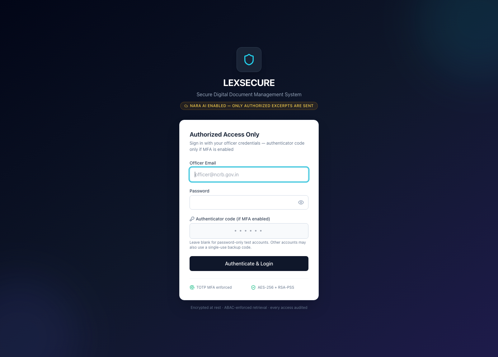

The badge at the top tells you how answers will be generated before you even
sign in — **“NARA AI ENABLED — ONLY AUTHORIZED EXCERPTS ARE SENT”** when an
external provider is configured, **“Local synthesis”** when the app stays
entirely offline.

| Control | What happens |
|---|---|
| bcrypt password | Never stored or logged in the clear |
| TOTP (RFC 6238) | Six digits from any authenticator app, ±1 step of clock drift |
| Replay protection | A code cannot be used twice |
| Backup codes | Ten single-use codes issued at enrolment |
| Lockout | 10 failures → 5 minutes, per IP **and** account, stored in the database |
| Token revocation | Signing out blacklists the JWT server-side |

Enrolment happens on first sign-in: the app shows a QR code, walks through
activation, then prints ten one-time backup codes.

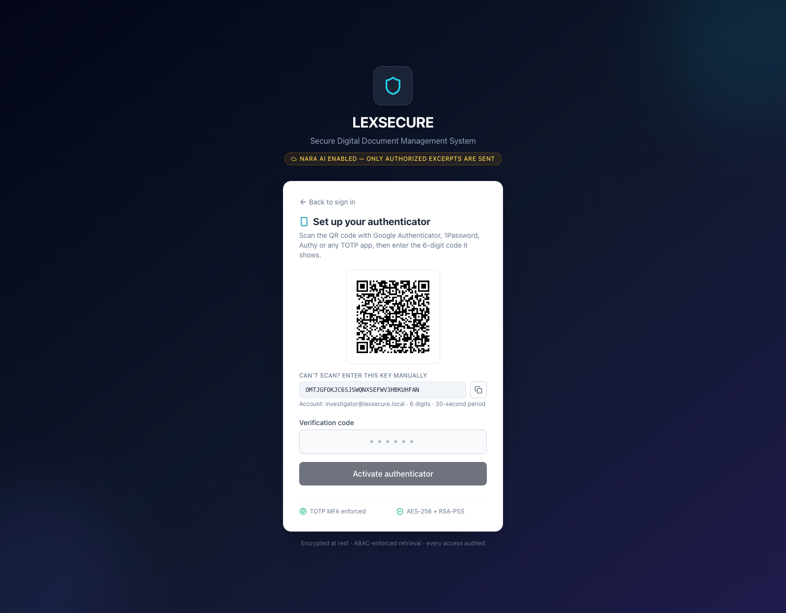

The manual key under the QR is the same secret in text form — paste it into an
authenticator app that cannot scan. The line beneath it tells you the account,
the digit count and the period, which is what an app asks for if you enter the
key by hand.

---

## 2. Dashboard


The live event stream sits in the header — **LIVE FEED** means the WebSocket
is connected. Every upload, signature, approval and tamper alert pushes to
every signed-in dashboard at once.

The four counters come from `/api/admin/system-health`. Below them:

- **Pending Two-Man Rule Approvals** — only visible to Supervisors and
  Administrators. Granting issues a 2-hour unlock token bound to that officer
  and that document.

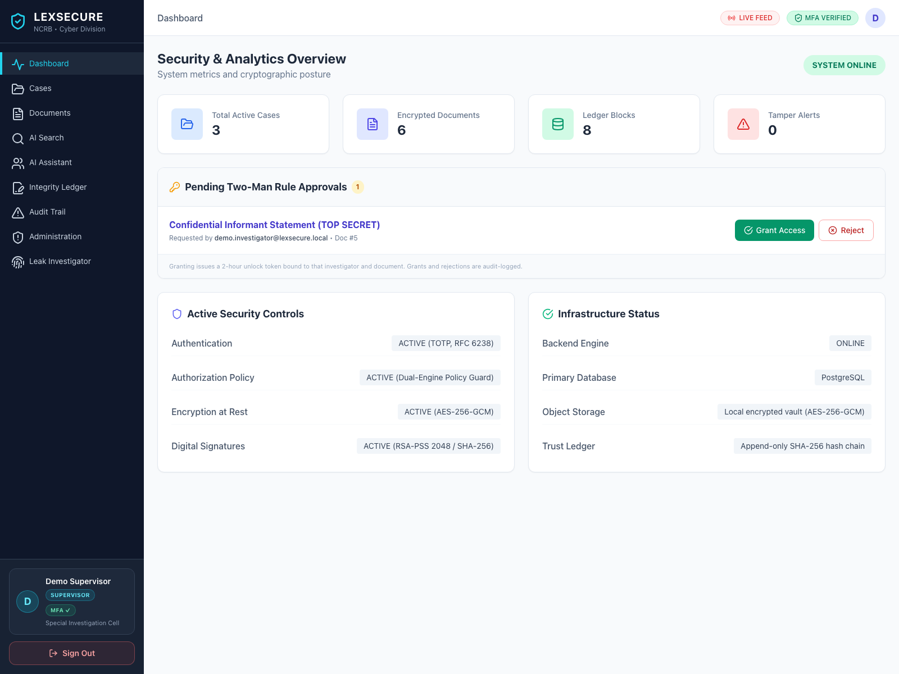
- **Active Security Controls** — the enforced posture, read from the same
  endpoint the audit trail records.

The avatar in the top-right opens a profile panel with your name, role, badge
number, MFA state and the cases you are assigned to — and the **Sign Out**
button that revokes your token server-side.

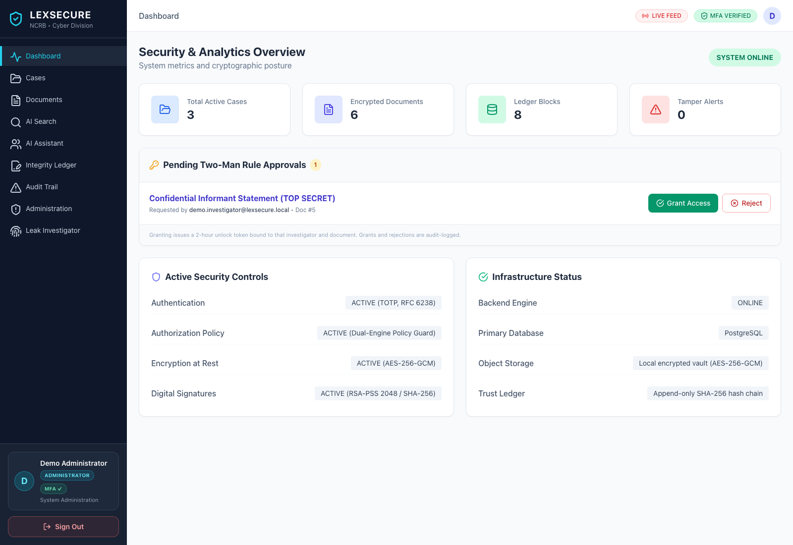

---

## 3. Cases

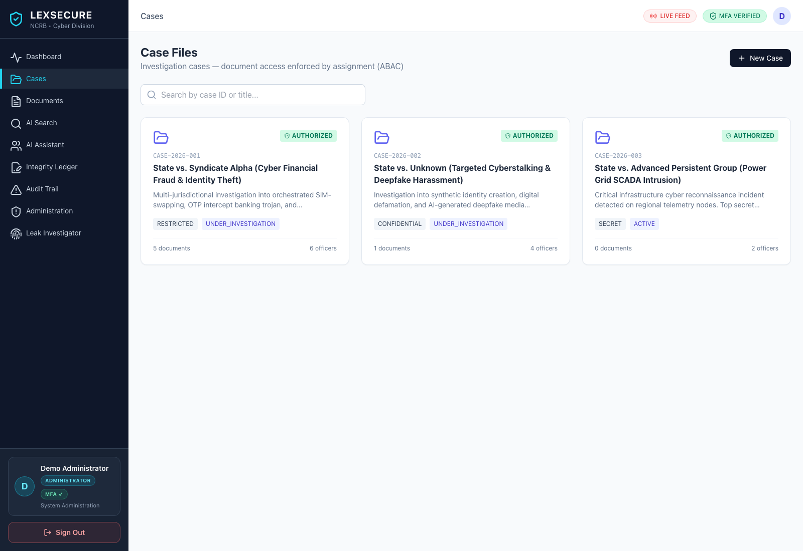

Every case is listed, but each card carries an **AUTHORIZED / NO ACCESS**
badge reflecting *your* assignment. Metadata is visible; evidence is not.

The boundary is enforced in SQL, not in the UI. Open a case you are not
assigned to and the API answers **403** — the frontend only renders what the
server allowed.

| Role | Cases reachable |
|---|---|
| Investigator | assigned cases only |
| Forensic Expert | assigned cases only |
| Legal Officer | assigned cases only |
| Supervisor / Administrator | all cases |

Here is that boundary in the interface — signed in as an Investigator who tries
to open a case they are not assigned to:

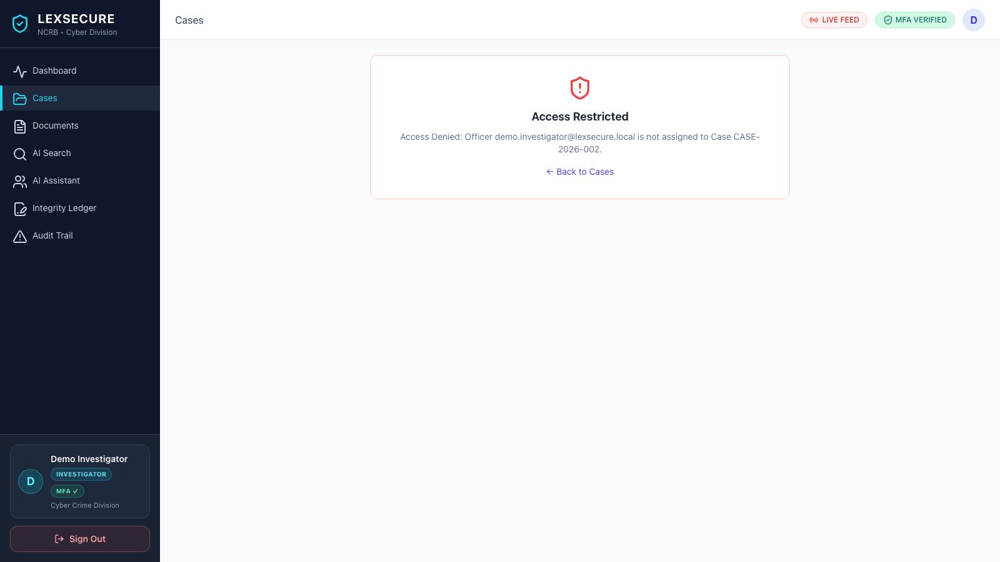

---

## 4. Case detail

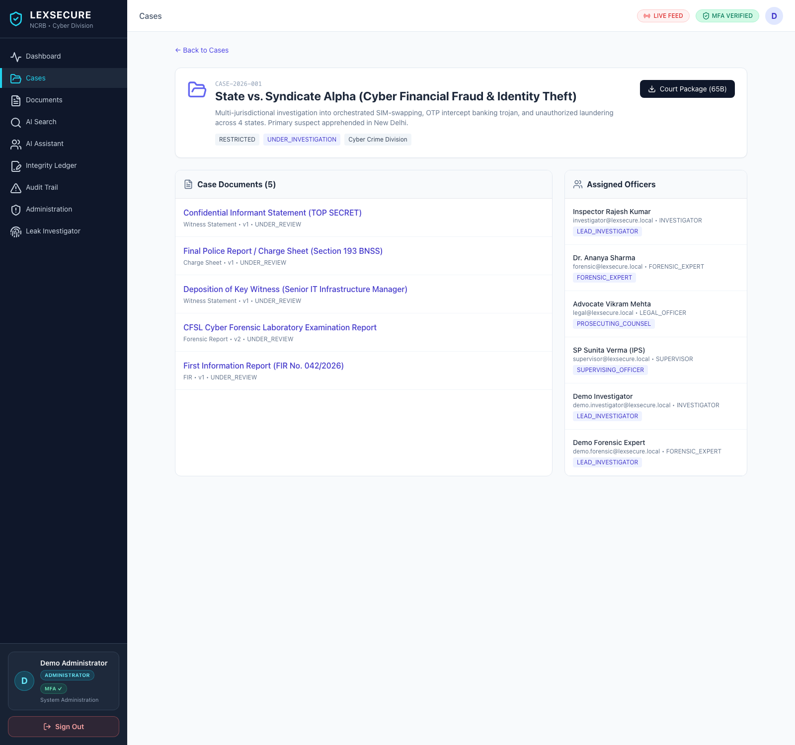

Documents in the case, the assigned officers, and — for a case you can reach —
the **Court Package (65B)** button.

That button generates a Section 65B / Bharatiya Sakshya Adhiniyam evidentiary
manifest: every document version with its SHA-256 hash, its RSA-PSS signature
list, and the ledger block that notarised it. It downloads as JSON and is
meant to be filed as-is.

---

## 5. Documents

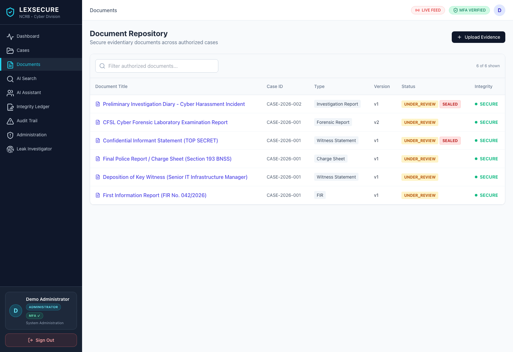

Every document you are cleared to see, with version, status and a live
integrity badge (**SECURE** / **⚠ ALERT**). Sealed documents carry a
**SEALED** badge.

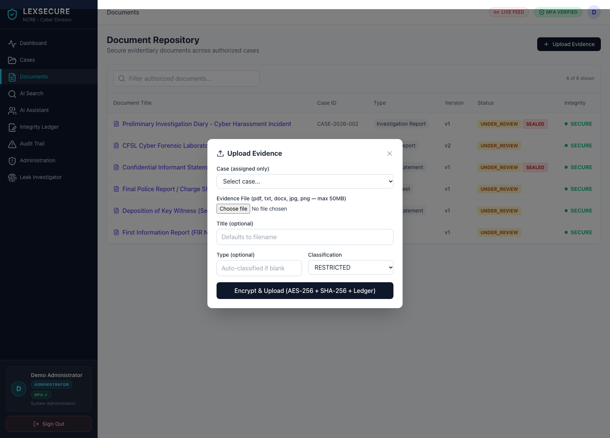

**Upload Evidence** runs the full pipeline on submit:

```
malware scan → text extract / OCR → classify → SHA-256 → RSA-PSS sign
             → AES-256-GCM encrypt → vault storage → ledger block
             → vector index → audit event
```

Nothing touches disk in the clear. The stored payload is AES-256-GCM sealed
with a 12-byte IV; the private signing key is itself encrypted at rest.

---

## 6. Document detail

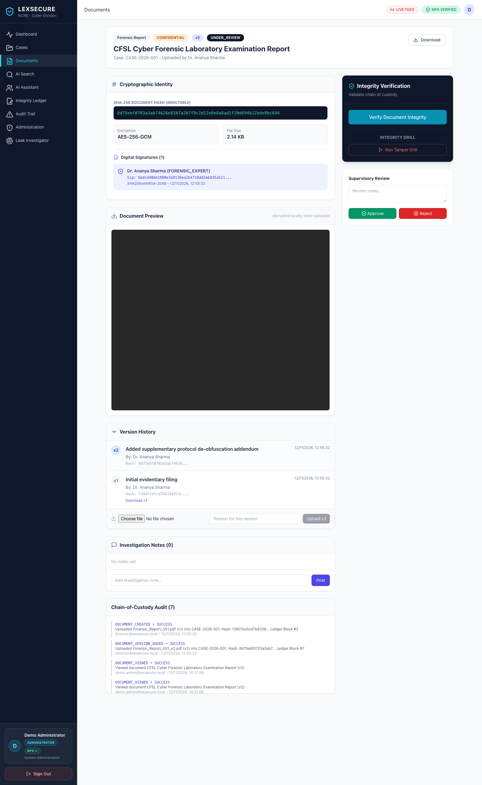

This is the crypto identity panel: the immutable SHA-256 digest, the cipher in
use, and the RSA-2048 signature with its signer, algorithm and timestamp.

Scroll down for an in-browser **preview** (PDF in an iframe, images rendered,
text as text), the **version history** with a reason per version, investigation
notes, and the full chain-of-custody audit for this document.

**Verify Document Integrity** re-checks three independent anchors at once:

1. decrypt the vault payload and re-hash it → compare to the stored digest
2. verify the RSA-PSS signature against that digest
3. confirm the ledger block for this version still matches

All three must pass. Any mismatch returns `TAMPERING_DETECTED`.

**Run Tamper Drill** (Supervisor/Admin) genuinely alters the stored bytes — it
is not a simulated flag. The AES-GCM tag then genuinely fails, the preview
refuses to render, and a `TAMPER_ALERT` fires on every open dashboard.
**Restore Clean Document** puts the sealed original back and re-verifies it.

---

## 7. Integrity Ledger

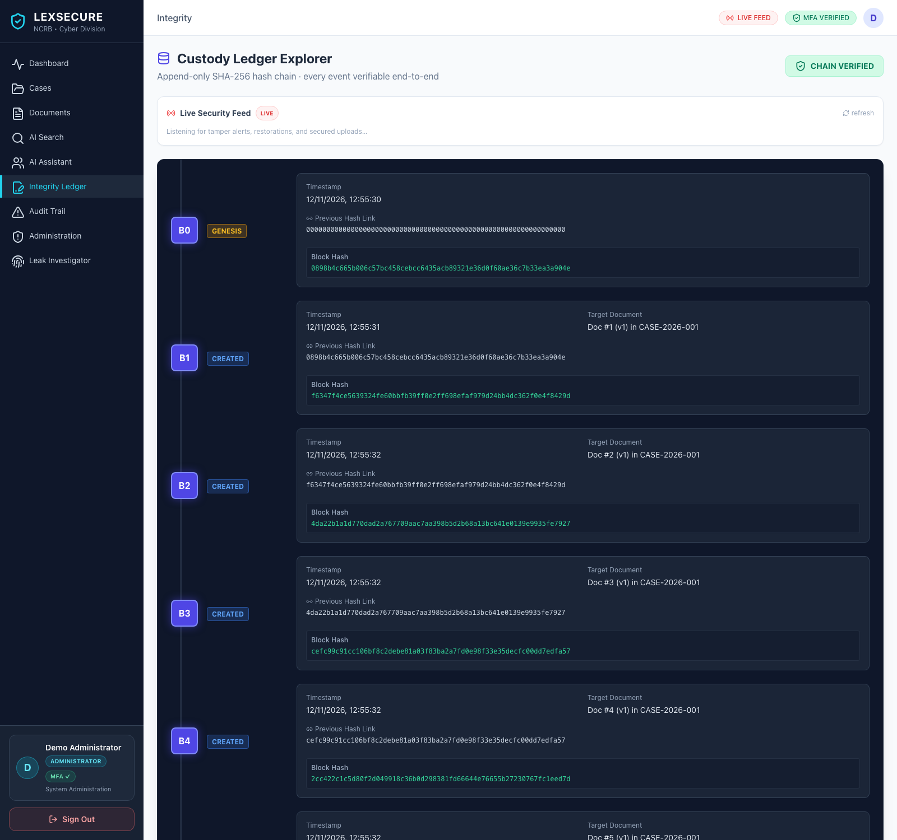

The append-only custody chain. Block **B0** is the genesis anchor (its
previous hash is 64 zeros); every block after it carries the SHA-256 of its
predecessor, so altering any historical block breaks every link that follows.

`CHAIN VERIFIED` is recomputed on demand, not cached — the endpoint re-derives
every block hash from the stored fields and walks the links.

**LIVE FEED** above the chain is the same WebSocket the dashboard uses. The
ledger view is scoped by ABAC: you see blocks for the cases you are assigned
to, supervisors and administrators see the whole chain.

---

## 8. AI Search

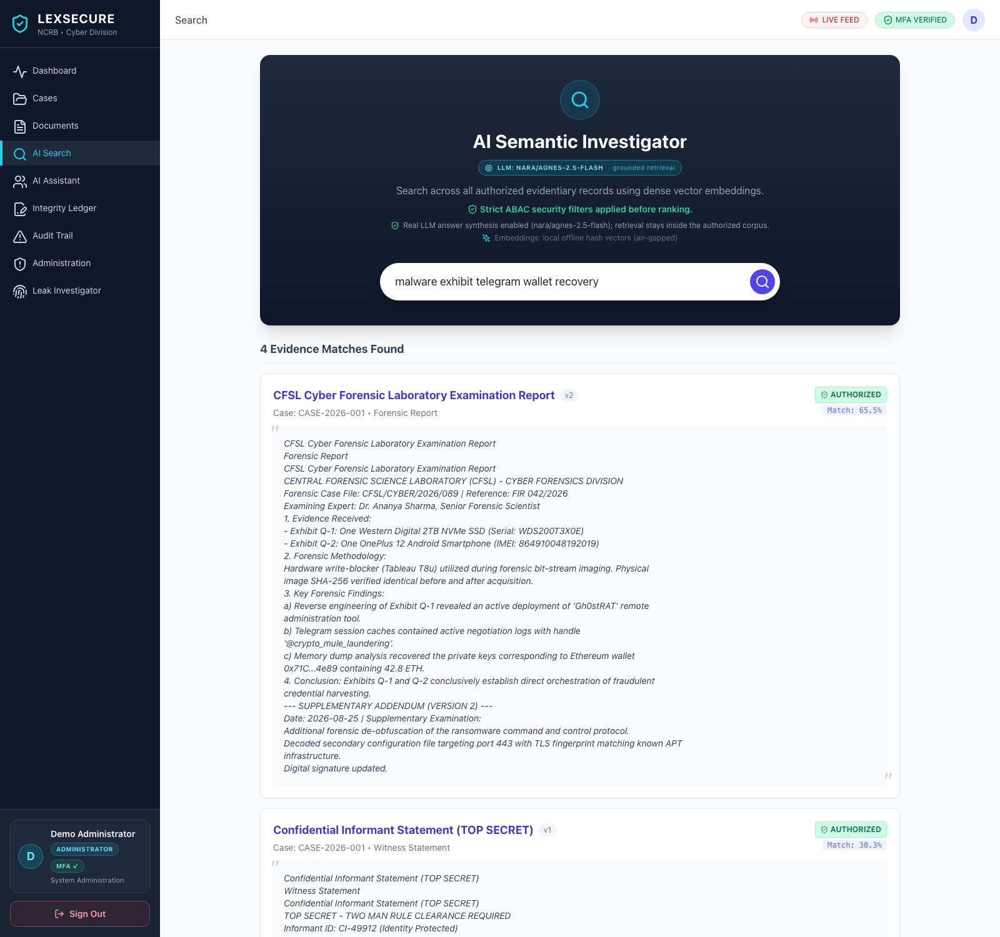

Semantic search over the evidence corpus using dense vector embeddings, with
lexical ranking blended in.

The critical property: **the ABAC filter runs before ranking**, so chunks you
are not cleared to see are never scored and never reach a model. The
`AUTHORIZED` badge and match score are computed over the already-filtered set.

A `TOP SECRET` document can appear here for a Supervisor and be entirely absent
for an Investigator — and the difference is visible in the result count.

---

## 9. AI Assistant

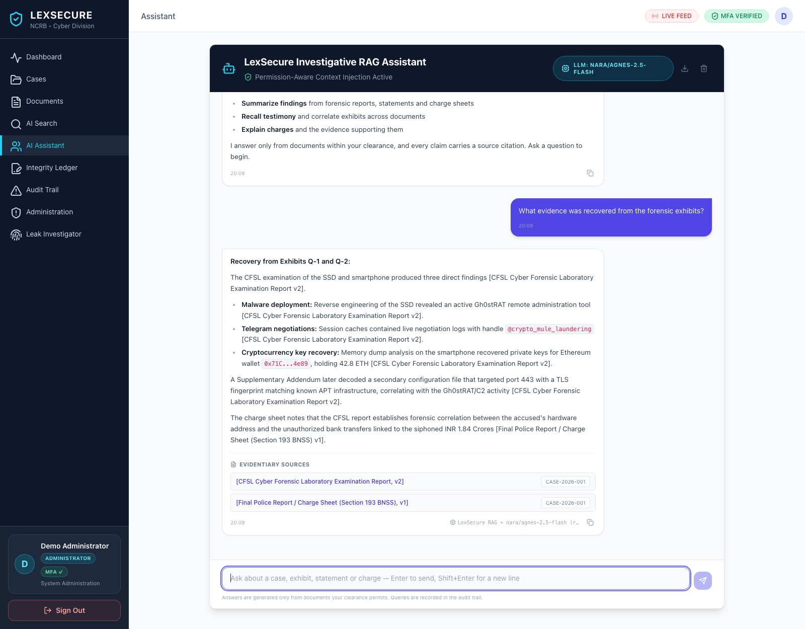

The RAG assistant answers questions over the authorized corpus and cites its
sources inline as `[Document Title vN]`.

Two things to notice in the capture:

- The answer names a **hardware serial number**, a **Telegram handle** and a
  **truncated ETH wallet** — all extracted from the real document text, not
  invented. When the provider is unavailable the app falls back to a
  deterministic template and says so in the footer rather than passing a
  template answer off as model output.
- The header badge names the live provider and model. The footer repeats that
  only authorized excerpts are sent.

Expect **30–45 s** per answer on the NaraRouter free tier — that is the
gateway's queue, not the app.

---

## 10. Audit Trail

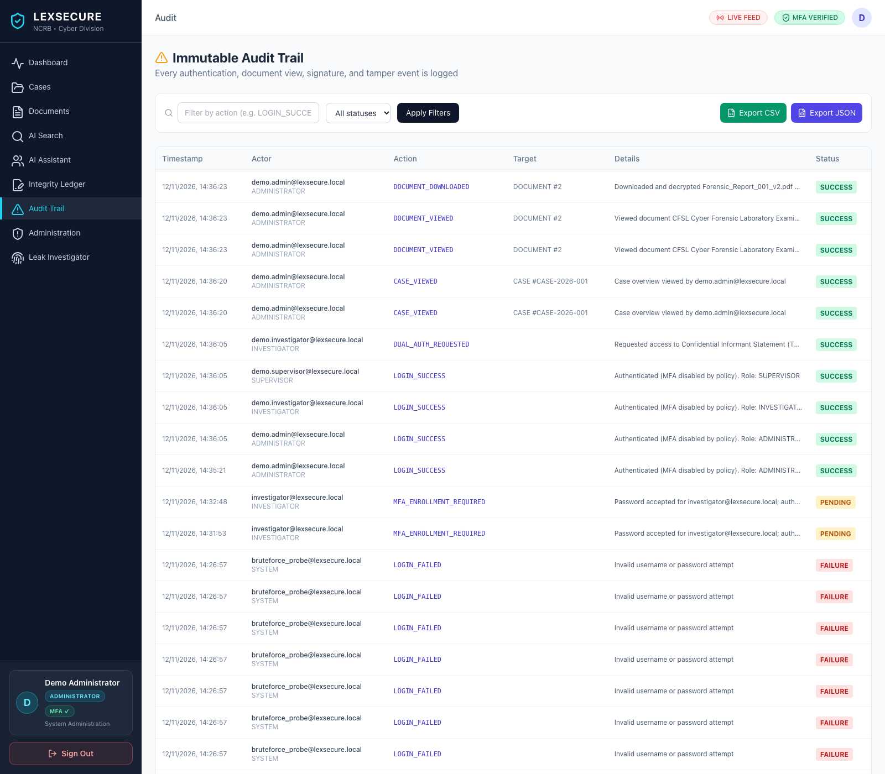

Every authentication, view, download, signature, approval and tamper event —
including the failed ones you can see above (`bruteforce_probe@` attempts from
the rate-limit test).

Non-supervisors see only their own events; Supervisors and Administrators see
everything.

**Export CSV / Export JSON** downloads the filtered trail with a
`X-Export-SHA256` header attesting to the exact bytes that were shipped. The
export is itself written back into the trail as `AUDIT_EXPORTED` with the same
hash, so the record of the record is chained too.

---

## 11. Administration

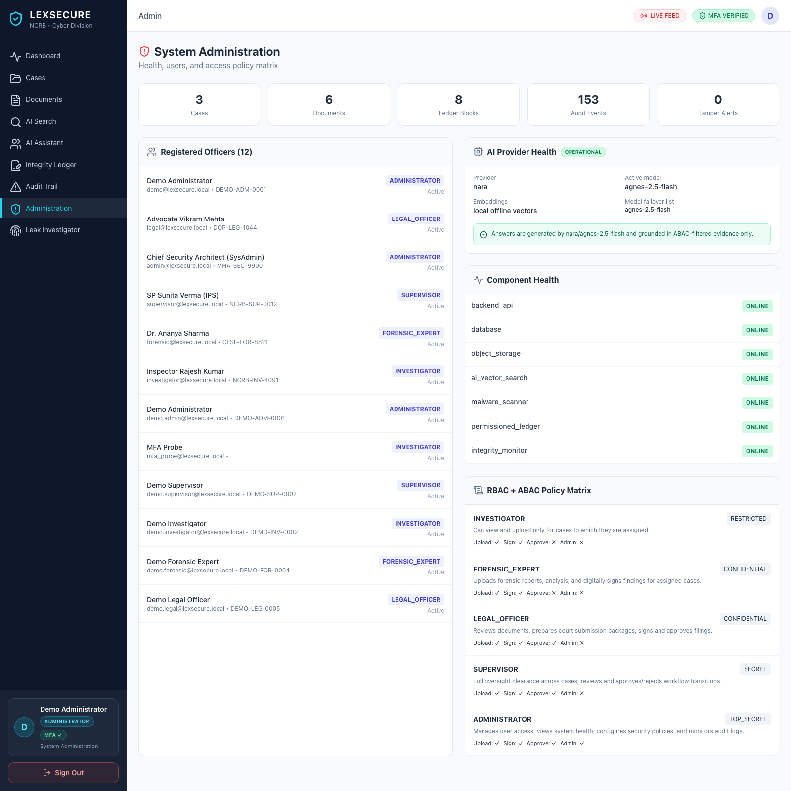

The officer directory, component health, the live AI provider state (provider,
active model, failover list, quota) and the RBAC + ABAC policy matrix.

The officer directory is Administrator-only. Supervisors get the health and
policy panels but see a clear notice instead of the directory — the API
answers **403**, and the UI says exactly that rather than showing an empty
table.

---

## 12. Leak Investigator

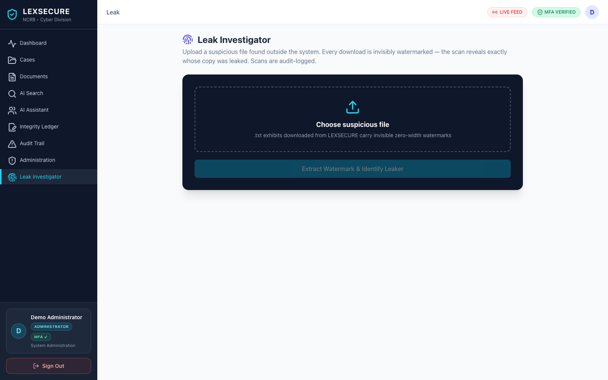

Text exhibits downloaded from LEXSECURE carry an invisible zero-width
watermark binding the copy to the downloading officer, the document version and
a timestamp. Rendered text is pixel-identical — the marks are U+200B and
U+200C characters appended after the content.

Upload a leaked file here and the scan reveals **whose copy it was**. The
payload carries a CRC-32, so a corrupted frame is reported as corrupted rather
than misattributed to the wrong officer.

Binary formats (PDF, PNG, …) are never watermarked — appending a frame would
corrupt their structure — so only text exhibits can be traced this way.

Every scan is audit-logged, including the empty ones.

---

## Try the five-minute demo

| # | Do this | Expect |
|---|---|---|
| 1 | Sign in as `demo.investigator@` | 1 case, 5 documents |
| 2 | Open CASE-2026-002 | **403 Access Restricted** |
| 3 | Sign in as `demo.supervisor@` | All 3 cases, 6 documents |
| 4 | AI Search "malware exhibit telegram wallet" | Investigator and Supervisor see different result sets |
| 5 | Run a tamper drill (Supervisor) | `TAMPER_ALERT` on every open dashboard; preview refuses to render |
| 6 | Restore the document | `TAMPER_RESOLVED`, integrity re-verified |
| 7 | Audit Trail → Export CSV | File downloads with an `X-Export-SHA256` attestation |

---

## 13. The Guide (inside the app)

Everything in this document is also built into the application as a **Guide**
section in the left sidebar, so a new user can learn the system without
leaving it.

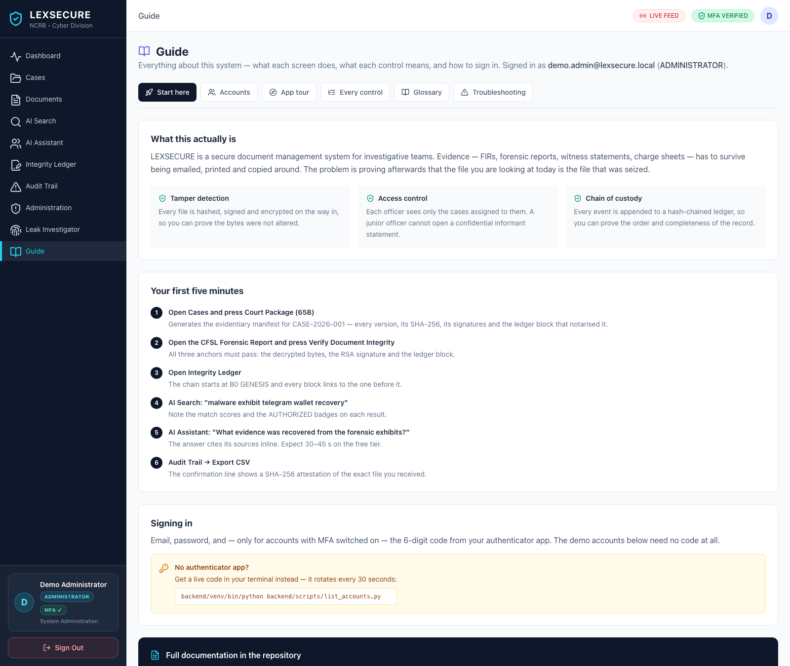

It has six tabs — **Start here**, **Accounts**, **App tour**, **Every
control**, **Glossary** and **Troubleshooting** — and the App tour tab links
directly to each screen. `/guide` is also reachable without a session, and the
login page links to it.

---

## Where the code is

| Screen | Backend | Frontend |
|---|---|---|
| Login, MFA | `backend/app/api/auth.py` | `frontend/src/pages/LoginPage.tsx` |
| Dashboard | `backend/app/api/admin.py` | `frontend/src/pages/DashboardPage.tsx` |
| Cases | `backend/app/api/cases.py` | `frontend/src/pages/CasesPage.tsx` |
| Documents | `backend/app/api/documents.py` | `frontend/src/pages/DocumentsPage.tsx` |
| Document detail | `backend/app/services/doc_processor.py`, `backend/app/security/pki.py` | `frontend/src/pages/DocumentDetailPage.tsx` |
| Integrity ledger | `backend/app/blockchain/ledger_service.py`, `backend/app/services/tamper_service.py` | `frontend/src/pages/IntegrityLedgerPage.tsx` |
| AI Search | `backend/app/ai/vector_store.py` | `frontend/src/pages/AISearchPage.tsx` |
| AI Assistant | `backend/app/ai/rag_engine.py`, `backend/app/ai/llm.py` | `frontend/src/pages/AIAssistantPage.tsx` |
| Audit trail | `backend/app/api/audit.py`, `backend/app/audit/logger.py` | `frontend/src/pages/AuditTrailPage.tsx` |
| Administration | `backend/app/api/admin.py` | `frontend/src/pages/AdminPage.tsx` |
| Leak investigator | `backend/app/services/steganography.py` | `frontend/src/pages/LeakInvestigatorPage.tsx` |
| Guide | — | `frontend/src/pages/GuidePage.tsx` |
| Live feed | `backend/app/api/ws.py` | `frontend/src/api/securityFeed.ts` |
| ABAC / RBAC | `backend/app/security/abac.py` | — |
| Encryption | `backend/app/security/crypto.py` | — |

See [ARCHITECTURE.md](ARCHITECTURE.md) for the pipeline, data model and API
surface.
