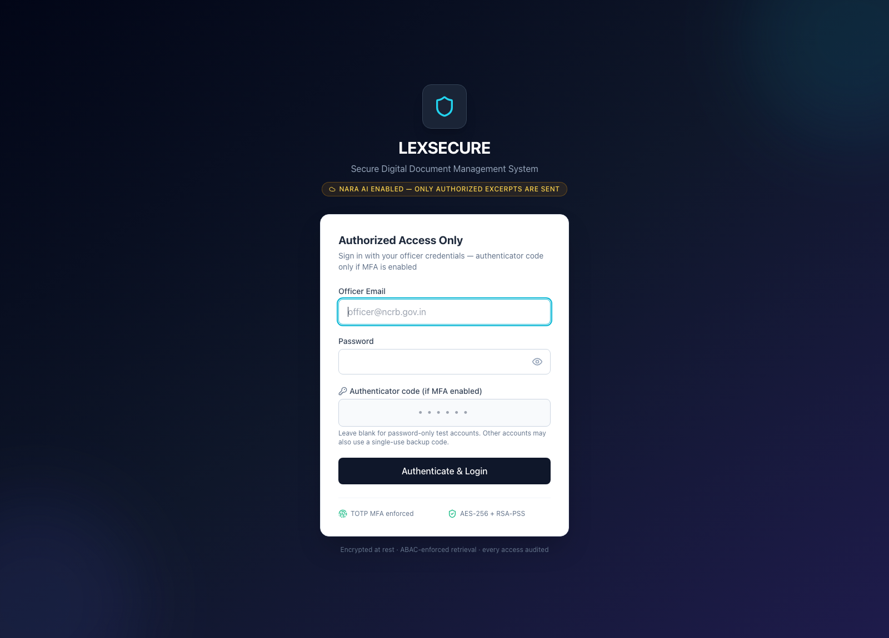
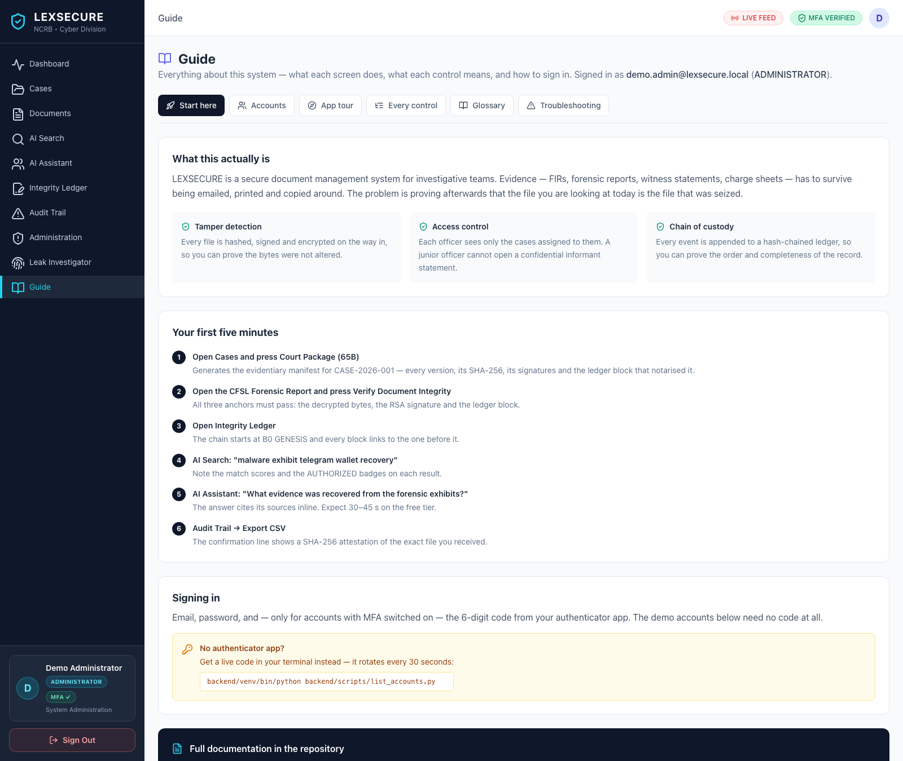
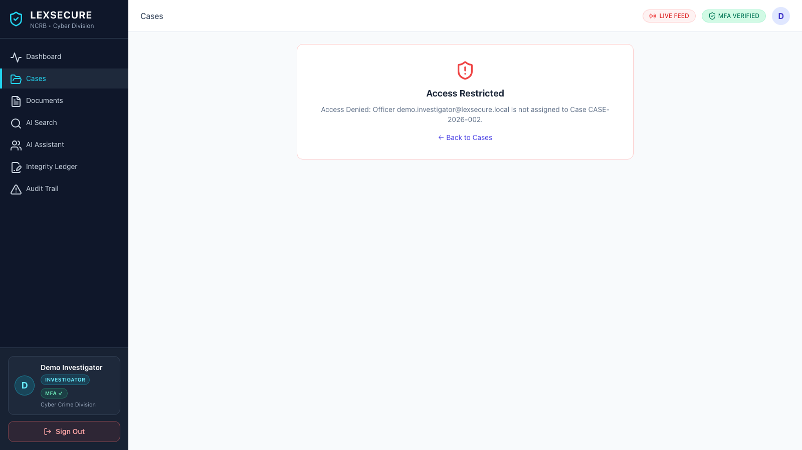
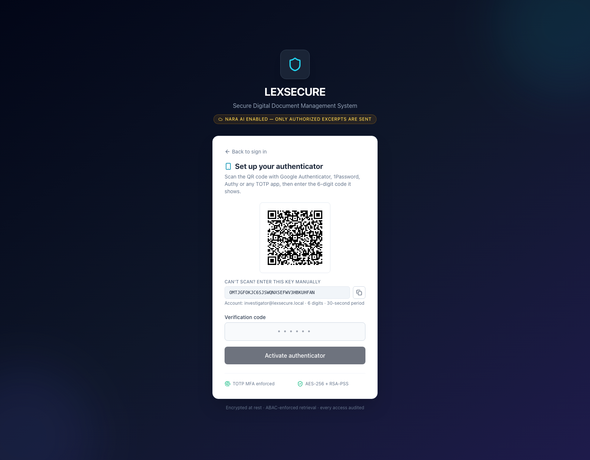
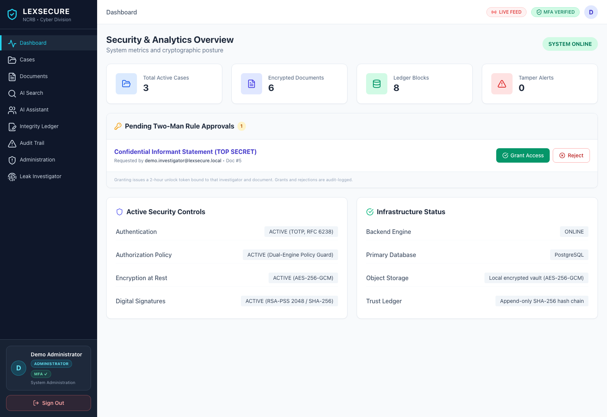

# LEXSECURE — Getting Started

**Read this first if you have never seen this project.** It assumes you know
nothing about it. After this page you will be able to sign in, understand every
thing on screen, and demo the whole system.

---

## 1. What this actually is

LEXSECURE is a **secure document management system for investigative teams**.

Police and legal teams collect evidence — FIRs, forensic reports, witness
statements, charge sheets, seizure memos — and that evidence has to survive
being handed around: stored, emailed, printed, copied, forwarded. The usual
problem is that nobody can prove afterwards that the file you are looking at
today is the same file that was seized.

LEXSECURE answers that with three things working together:

| | What it does | Why it matters |
|---|---|---|
| **Tamper detection** | Every file is hashed, digitally signed and encrypted on the way in | You can prove the bytes were not altered |
| **Access control** | Each officer only sees the cases they are assigned to | A junior officer cannot open a confidential informant statement |
| **Chain of custody** | Every event is appended to a hash-chained ledger | You can prove the order and completeness of the record |

Plus two things that make it usable day to day:

- **Leak tracking** — every text document you download is invisibly stamped
  with your identity. If a copy leaks, you can find out who let it out.
- **An AI assistant** that answers questions about the evidence and cites its
  sources, without ever being able to read a document you are not cleared for.



---

## 2. The in-app Guide

The fastest way in is the **Guide** section in the left sidebar of the
application — it is the same material as these docs, in the app, where you can
click straight through to any screen.



It has six tabs: **Start here**, **Accounts**, **App tour**, **Every
control**, **Glossary** and **Troubleshooting**. The App tour tab has a live
capture of every screen with a link that opens it.

If you are not signed in yet, `/guide` still opens — it is the one page you can
read before authenticating, and the login screen links to it.

---

## 3. Running it

You need **Python 3.10+**, **Node.js 18+** and either **PostgreSQL 16** or
**Docker**.

```bash
git clone <your-repo-url>
cd lexsecure
./start.sh
```

`start.sh` starts PostgreSQL (if the bundled cluster exists), the FastAPI
backend on **:8000** and the React frontend on **:5173**. Then open:

> **http://localhost:5173**

First run only — create the sample data and the demo accounts:

```bash
cd backend
venv/bin/python seed.py                      # 3 cases, 6 documents, ledger blocks
venv/bin/python scripts/create_demo_accounts.py   # 6 password-only accounts
```

Check it is alive:

```bash
curl http://localhost:8000/health
```

---

## 4. Signing in


### Every element on this screen

| Element | What it is |
|---|---|
| **NARA AI ENABLED** badge | Tells you how AI answers will be produced. Amber = an external provider is configured and only your authorized excerpts are sent to it. Green = the app is running fully offline and nothing leaves this machine. |
| **Officer Email** | Your account address. Case-insensitive. |
| **Password** | Your account password. Click the eye icon to reveal it. |
| **Authenticator code** | The 6-digit code from your authenticator app. **Leave it blank on the demo accounts.** |
| **Authenticate & Login** | Submits. A red banner above the form explains any failure. |
| **TOTP MFA enforced / AES-256 + RSA-PSS** | A static footer describing the controls that are always on. |

### Error messages you might see

| Message | What happened | What to do |
|---|---|---|
| `Incorrect email or password.` | The email or password is wrong | Check spelling — the demo emails end `@lexsecure.local` |
| `This account requires an authenticator code.` | MFA is on and you left the code blank | Get a code (see below) |
| `Invalid or already-used verification code.` | The code was wrong, expired, or already spent | Get a **fresh** code — codes are single-use |
| `Too many failed attempts. Please wait 5 minutes.` | 10 failures for this IP + account | Wait 5 minutes; the lockout is stored in the database, so restarting does not help |
| `This temporary account has expired.` | A time-limited test account ran out | Use a normal account |
| `Access Restricted` | You are signed in but not cleared for that case | Ask a supervisor to assign you |

---

## 5. The accounts — pick the right one

### Demo accounts (password only, no authenticator app)

**These are the ones to use for a demo, a screenshot, or a first look.** All
use the password `Demo@LexSecure2026` and never expire.

| Email | Role | Sees | Use it to show |
|---|---|---|---|
| `demo.admin@lexsecure.local` | Administrator | everything | The full system, the officer directory, health panels |
| `demo.supervisor@lexsecure.local` | Supervisor | every case | Oversight, approval queues, integrity drills |
| `demo.investigator@lexsecure.local` | Investigator | **CASE-2026-001 only** | The ABAC boundary — open CASE-2026-002 and get a 403 |
| `demo.forensic@lexsecure.local` | Forensic Expert | CASE-2026-001, -002 | Forensic reports across two cases |
| `demo.legal@lexsecure.local` | Legal Officer | CASE-2026-002, -003 | Charge sheets and court packages |
| `demo@lexsecure.local` | Administrator | everything | Short alias for the admin account |

> **Tip for the demo:** sign in as `demo.investigator@` first and try to open
> CASE-2026-002. You will get a red **Access Restricted** panel. Then sign in
> as `demo.supervisor@` and open the same case — it opens. That contrast is
> the single clearest way to show what the access control actually does.



### Seeded accounts (real authenticator required)

These are the "proper" officers from `seed.py`. They need a TOTP code, which
either comes from an authenticator app or from the terminal:

| Email | Role | Password |
|---|---|---|
| `investigator@lexsecure.local` | Inspector Rajesh Kumar | `LexSecure@2026` |
| `forensic@lexsecure.local` | Dr. Ananya Sharma | `LexSecure@2026` |
| `legal@lexsecure.local` | Advocate Vikram Mehta | `LexSecure@2026` |
| `supervisor@lexsecure.local` | SP Sunita Verma (IPS) | `LexSecure@2026` |
| `admin@lexsecure.local` | Chief Security Architect (SysAdmin) | `LexSecure@2026` |

**Getting a code without an authenticator app:**

```bash
backend/venv/bin/python backend/scripts/list_accounts.py
```

That prints every account, its role, whether it is active, its password, and a
**live rotating 6-digit code** in the last column.

**Or set one up properly** — scan the QR code with Google Authenticator,
1Password, Authy or any TOTP app:



### Setting up the authenticator, step by step

1. Sign in with the email and password only.
2. The app detects that no authenticator is bound and shows **Set up your
   authenticator**.
3. Scan the QR code with your authenticator app.
   *Can't scan?* The manual key under the QR (`OMTJGFOKJC6SJSWQNXSEFWV3HBKUHFAN`
   above) is the same secret in text form — paste it into the app's "enter
   key" box.
4. Type the 6-digit code the app is now showing.
5. Press **Activate authenticator**.
6. The app shows **ten one-time backup codes**. Write them down or download
   them — they are shown exactly once and each works a single time.

The manual key line also tells you the account, the digit count and the period
(30 seconds) — the three things you need if your app asks for them.

---

## 6. The shell — what every part means


### Left sidebar

| Item | What it does |
|---|---|
| **LEXSECURE / NCRB · Cyber Division** | The product identity. Not clickable. |
| **Dashboard** | System metrics, your pending approvals, and the health of every subsystem. |
| **Cases** | Every investigation case, each badged AUTHORIZED or NO ACCESS depending on your assignment. |
| **Documents** | Every document you are cleared to see, plus the upload button. |
| **AI Search** | Semantic search across the evidence. |
| **AI Assistant** | Ask questions in plain language and get a cited answer. |
| **Integrity Ledger** | The append-only custody chain. |
| **Audit Trail** | Every security event, filterable and exportable. |
| **Administration** | Officer directory, health panels, policy matrix. *Supervisors and Administrators only.* |
| **Leak Investigator** | Trace a leaked file back to the officer who downloaded it. *Supervisors and Administrators only.* |
| **Your name / role / department** | Who you are signed in as, and your MFA status. |
| **Sign Out** | Ends the session **and blacklists the token server-side**. |

### Top bar

| Item | What it means |
|---|---|
| **LIVE FEED** | The WebSocket to the server is connected — tamper alerts and uploads arrive instantly. **FEED OFFLINE** means it is reconnecting. |
| **MFA VERIFIED** | Your second factor was checked for this session. |
| **D** (avatar) | Your profile menu — name, role, badge number, MFA state and the cases you are assigned to. Click **Sign Out** inside it to end the session. |



---

## 7. Your first five minutes

1. **Sign in as `demo.admin@lexsecure.local` / `Demo@LexSecure2026`**
2. **Dashboard** — note the four counters and the green SYSTEM ONLINE badge.
3. **Cases** — open CASE-2026-001, then press **Court Package (65B)** to
   generate the evidentiary manifest.
4. **Documents → CFSL Cyber Forensic Laboratory Examination Report** — look at
   the SHA-256 hash and the RSA-2048 signature, then press **Verify Document
   Integrity**. All three anchors must pass.
5. **Integrity Ledger** — the chain starts at B0 GENESIS and every block links
   to the one before it.
6. **AI Search** — search `malware exhibit telegram wallet recovery`. Note the
   match scores and the AUTHORIZED badges.
7. **AI Assistant** — ask *What evidence was recovered from the forensic
   exhibits?* and watch the citations appear.
8. **Audit Trail** — press **Export CSV** and confirm the SHA-256 attestation
   appears in the confirmation line.

---

## 8. Troubleshooting

| Symptom | Cause | Fix |
|---|---|---|
| "Backend API unreachable" banner | The API on :8000 is not running | `./start.sh` |
| "Incorrect email or password" | Typo, or the demo password was changed | `backend/venv/bin/python backend/scripts/create_demo_accounts.py` |
| "This account requires an authenticator code" | MFA account, blank code | `list_accounts.py` for a live code |
| "Invalid or already-used verification code" | Code expired (30 s) or already spent | Get a new one — codes are single-use |
| "Too many failed attempts" | 10 failures → 5-minute lockout | Wait 5 minutes |
| Pages are empty, no error | The database has no seed data | `cd backend && venv/bin/python seed.py` |
| `connection refused` on :8000 | Backend crashed | `tail -f backend/uvicorn.log` |
| AI answers are slow (30–45 s) | The NaraRouter free tier queues | Expected. The deterministic fallback is instant. |
| AI badge says "Local synthesis" | No `NARA_API_KEY` in `backend/.env` | Add the key and restart |
| `uvicorn: command not found` | The venv is missing or was moved | `cd backend && python3 -m venv venv && venv/bin/pip install -r requirements.txt` |

---

## 9. Glossary

| Term | Meaning |
|---|---|
| **ABAC** | Attribute-Based Access Control — access depends on *your assignment to a case*, not just your job title |
| **RBAC** | Role-Based Access Control — access depends on your role |
| **TOTP** | Time-based One-Time Password — the 6-digit authenticator code (RFC 6238) |
| **MFA / 2FA** | Multi-factor authentication — password **plus** something you hold |
| **Hash (SHA-256)** | A one-way fingerprint of a file. Change one byte and the whole hash changes |
| **Signature (RSA-PSS)** | A cryptographic proof that *this officer* approved *this exact hash* |
| **AES-256-GCM** | Encryption with authentication — tampered ciphertext fails to decrypt |
| **Two-Man Rule** | A document stays sealed until a second, senior officer grants access |
| **Ledger block** | One entry in the append-only custody chain |
| **Genesis block** | Block B0 — the anchor that starts the chain |
| **Replay protection** | A TOTP code cannot be used twice, even inside its time window |
| **Custody chain** | The unbroken sequence of who touched a document, in order |
| **Vault** | The encrypted local storage where document bytes live |
| **Embedding** | A numeric vector representing the meaning of a piece of text |
| **RAG** | Retrieval-Augmented Generation — look up relevant evidence, then answer from it |
| **Leak tracker** | The invisible zero-width stamp inside downloaded text documents |

---

## Where to next

- **[App Tour](APP_TOUR.md)** — a walkthrough of every screen with screenshots
- **[UI Reference](UI_REFERENCE.md)** — every button, badge and field, explained
- **[Architecture Guide](ARCHITECTURE.md)** — how it works underneath
- **[API Reference](API.md)** — every endpoint
