# LEXSECURE — UI Reference

**What every button, badge, field and panel does.** Organized screen by
screen. Cross-referenced with the [App Tour](APP_TOUR.md) for the narrative
walkthrough and [Getting Started](GETTING_STARTED.md) for setup.

---

## Global chrome

Every screen except the login page sits inside the same shell.

### Sidebar

| Element | Meaning |
|---|---|
| **LEXSECURE** logo block | Product identity, division name |
| Nav item — *highlighted* | The page you are on |
| **Dashboard** | Metrics, approvals queue, control posture |
| **Cases** | Case register |
| **Documents** | Document repository + upload |
| **AI Search** | Semantic search |
| **AI Assistant** | Conversational Q&A over evidence |
| **Integrity Ledger** | Custody chain explorer |
| **Audit Trail** | Event log + export |
| **Administration** | *Supervisor/Administrator only* |
| **Leak Investigator** | *Supervisor/Administrator only* |
| Avatar block | Name, role chip, `MFA ✓` chip, department |
| **Sign Out** | Clears the session and revokes the token server-side |

### Top bar

| Element | Meaning |
|---|---|
| Page title | Current route |
| **LIVE FEED** (red, pulsing) | WebSocket connected — live events are arriving |
| **FEED OFFLINE** (grey) | WebSocket reconnecting; the UI still works, it just is not live |
| **MFA VERIFIED** (green) | Second factor confirmed for this session |
| **D** avatar | Opens the profile menu |

---

## Login

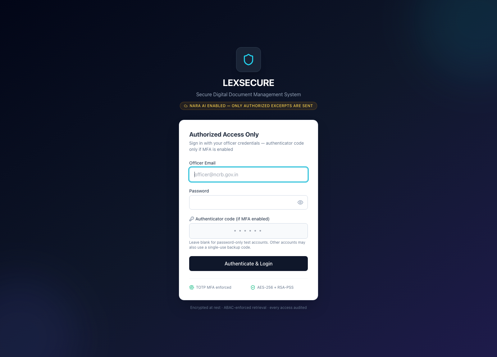

| Element | What it does |
|---|---|
| Provider badge | **NARA AI ENABLED** → an external model will answer, but only with your authorized excerpts. **LOCAL SYNTHESIS** → fully offline, nothing leaves the machine. |
| Officer Email | Your account address |
| Password | With a reveal toggle |
| Authenticator code | 6-digit TOTP, or a single-use backup code. Blank for password-only accounts |
| Authenticate & Login | Submits |
| Error banner | Red panel explaining exactly what failed |

### MFA enrolment screen

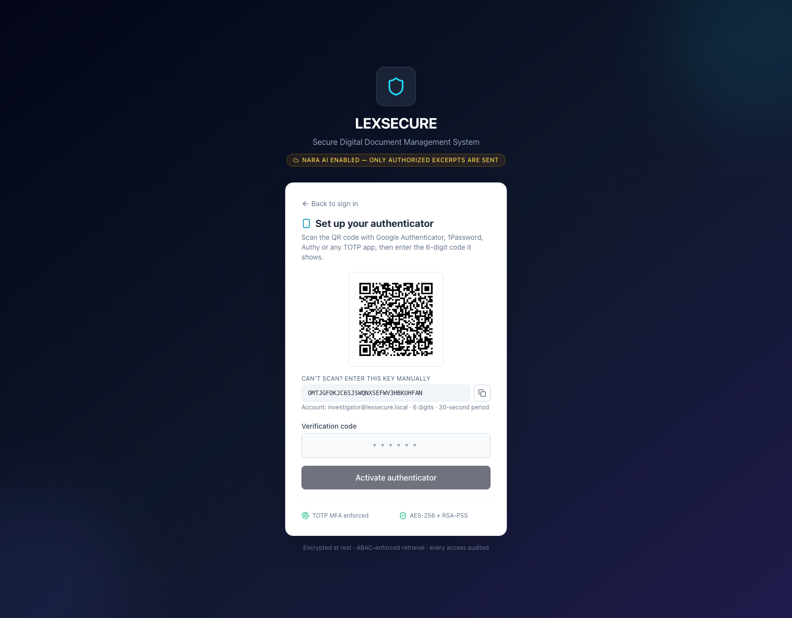

| Element | What it does |
|---|---|
| **Back to sign in** | Abandons enrolment and returns to the login form |
| QR code | The `otpauth://` secret, ready to scan with any TOTP app |
| **Can't scan? Enter this key manually** | The same secret as text — paste into your app's manual-entry box |
| Copy icon | Copies that manual key |
| `Account: … · 6 digits · 30-second period` | The three parameters your app needs if it asks |
| Verification code | The code your app is now showing |
| **Activate authenticator** | Confirms and issues ten one-time backup codes |

---

## Dashboard

| Element | Meaning |
|---|---|
| **SYSTEM ONLINE** | No tampered versions in the database right now. Turns to **SECURITY ALERT** if any exist. |
| **Total Active Cases** | Cases in the database |
| **Encrypted Documents** | Documents stored |
| **Ledger Blocks** | Entries in the custody chain |
| **Tamper Alerts** | Versions currently failing integrity verification |
| **Pending Two-Man Rule Approvals** | Sealed documents waiting for a senior officer to decide. Each row: title, requester, and **Grant Access** / **Reject**. |
| **Grant Access** | Issues a 2-hour unlock token bound to that officer and that document. Audit-logged. |
| **Reject** | Denies access. Also audit-logged. |
| **Active Security Controls** | The enforced posture, read live from the API |
| **Infrastructure Status** | Which database engine, storage backend and ledger type are running |

---

## Cases

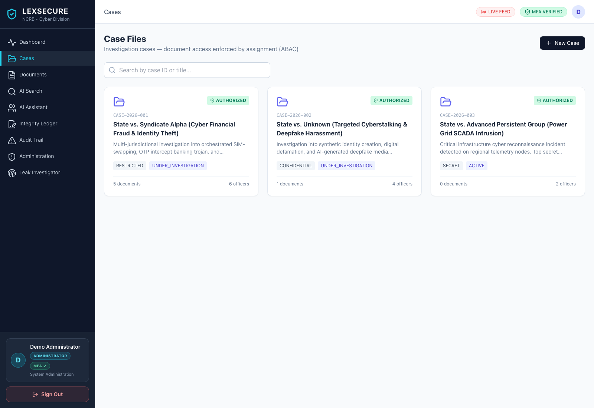

| Element | Meaning |
|---|---|
| **New Case** | Creates a case. You are auto-assigned to it as lead investigator. |
| Search box | Filters by case ID or title |
| **AUTHORIZED** (green) | You are assigned to this case — you can open it |
| **NO ACCESS** (grey) | You are not assigned. The card is still visible because case *metadata* is not itself evidence. Opening it returns 403. |
| Classification chip | `RESTRICTED` / `CONFIDENTIAL` / `SECRET` |
| Status chip | `UNDER_INVESTIGATION`, `COURT_PENDING`, `CLOSED` |
| *n* documents / *n* officers | Counts, not contents |

### Case detail

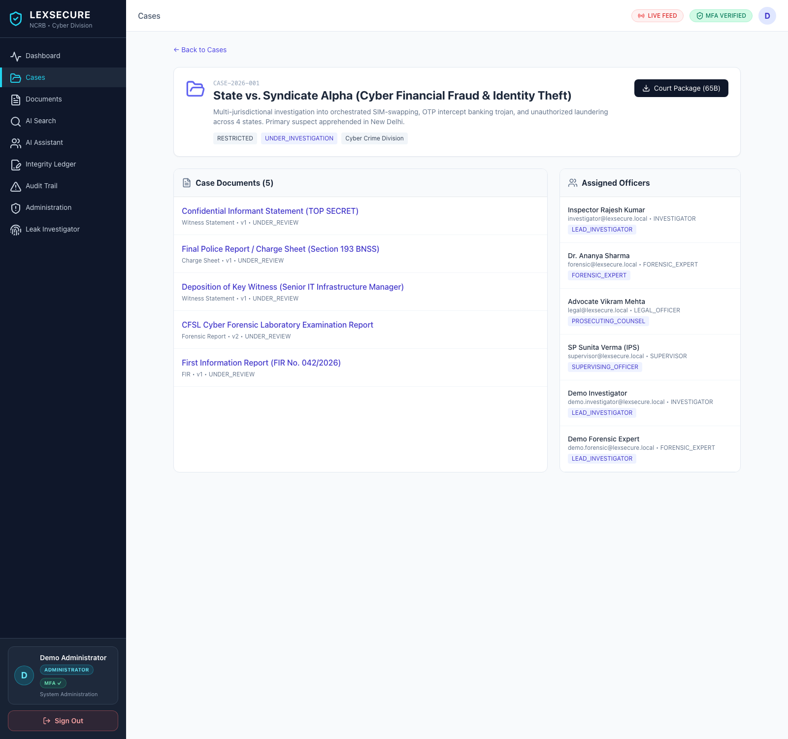

| Element | Meaning |
|---|---|
| **Court Package (65B)** | Generates the Section 65B / Bharatiya Sakshya Adhiniyam evidentiary manifest: every version with its SHA-256, its signatures, and the notarising ledger block. Downloads as JSON. |
| **Case Documents** | The documents in this case. `v1`, `v2` is the version. Status shows the review state. `⚠ TAMPERED` means integrity failed. |
| **Assigned Officers** | Who is cleared, and in what role |

---

## Documents

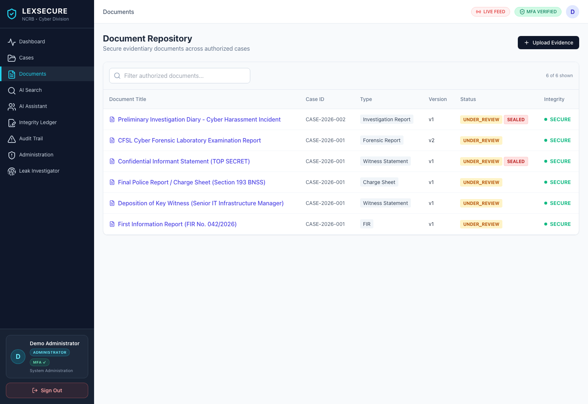

| Column | Meaning |
|---|---|
| **Document Title** | Click to open |
| **Case ID** | Which case it belongs to |
| **Type** | FIR, Forensic Report, Witness Statement, Charge Sheet… |
| **Version** | `v1`, `v2`… each version is separately hashed, signed and anchored |
| **Status** | `DRAFT` → `UNDER_REVIEW` → `SIGNED` / `APPROVED` / `REJECTED` |
| **SEALED** (red) | Under the Two-Man Rule — a supervisor must grant access before it opens |
| **Integrity** | **SECURE** (green) = verified; **⚠ ALERT** (red) = failed verification |

### Upload dialog

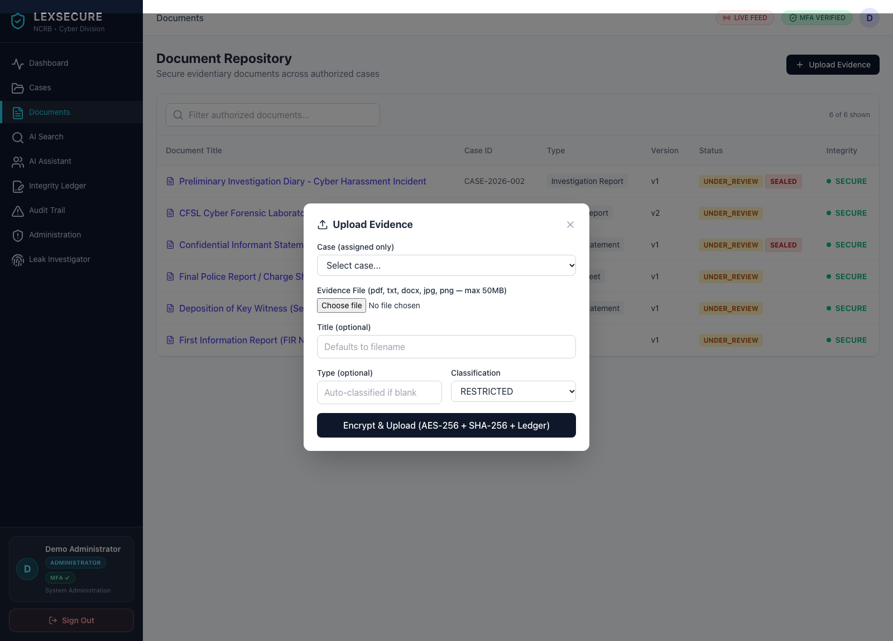

| Field | What it does |
|---|---|
| **Case (assigned only)** | Only cases you are assigned to appear |
| **Evidence File** | pdf, txt, docx, jpg, png — max 50 MB. Scanned before it is stored. |
| **Title (optional)** | Defaults to the filename with underscores turned into spaces |
| **Type (optional)** | Auto-classified from the content if you leave it blank |
| **Classification** | `RESTRICTED` / `CONFIDENTIAL` / `SECRET` / `TOP_SECRET`. `SECRET` and above need lead-investigator clearance to read. |
| **Encrypt & Upload** | Runs the whole pipeline: scan → OCR → classify → hash → sign → encrypt → store → ledger → index → audit |

### Document detail

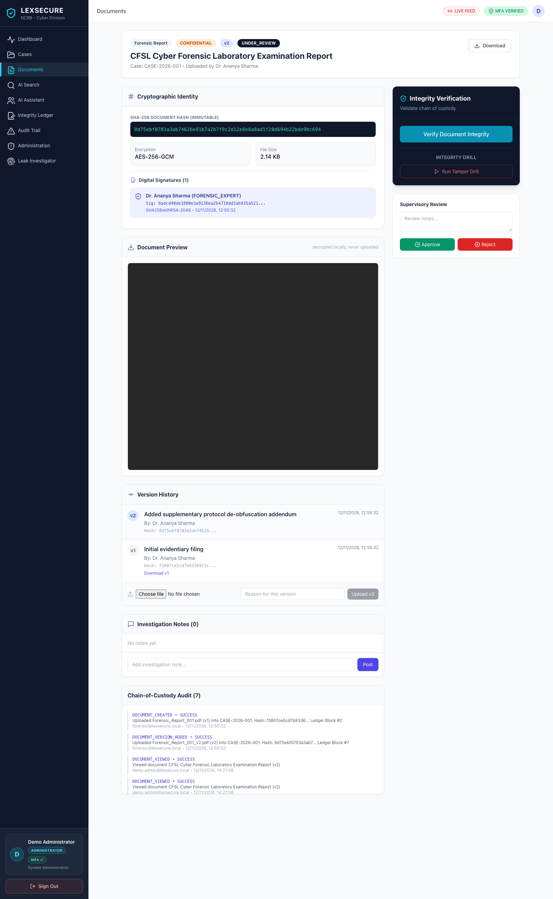

| Element | Meaning |
|---|---|
| Type / classification / version / status chips | The document's current state |
| **SHA-256 Document Hash (Immutable)** | The fingerprint of this exact version. One changed byte changes the whole hash. |
| **Encryption** | `AES-256-GCM` |
| **File Size** | Size of the decrypted original |
| **Digital Signatures** | Who signed, with the algorithm, the signature hex and the timestamp |
| **Download** | Decrypts and streams the original. Text documents are invisibly watermarked on the way out. |
| **Sign (RSA-2048)** | Signs the current version with your private key and notarises it on the ledger |
| **Unsign (Revoke Mine)** | Removes your own signature. The revocation itself is notarised and audited — removing a signature is not a way to hide it. |
| **Document Preview** | Rendered in the browser. PDFs in an iframe, images as images, text as text. A tampered payload cannot be decrypted, so the preview explains instead of failing. |
| **Version History** | Every version with its reason, author, timestamp and hash. Upload a new version with a reason. |
| **Investigation Notes** | Free-text notes attached to the document, audited. |
| **Chain-of-Custody Audit** | Every event for this document, oldest first |
| **Verify Document Integrity** | Re-checks all three anchors. |
| **Run Tamper Drill** | *Supervisor/Admin.* Genuinely alters the stored bytes so the detection stack can be exercised end to end. |
| **Restore Clean Document** | *Supervisor/Admin.* Puts the sealed original back and re-verifies it. |
| **Supervisory Review** | *Supervisor/Legal Officer/Admin.* Approve or reject with notes. |
| **Integrity report panel** | The result: hash mismatch details, decryption status, signature status, ledger status |

---

## Integrity Ledger

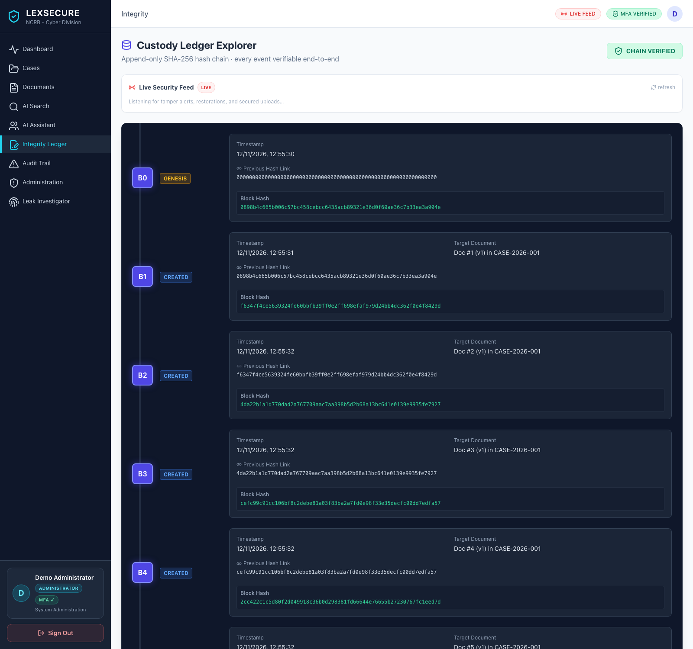

| Element | Meaning |
|---|---|
| **CHAIN VERIFIED** (green) | Every block hash re-derived and every link checked. Recomputed on each load, not cached. |
| **CHAIN ... DETECTED** (red) | A block was altered — the panel names the offending block number |
| **Live Security Feed** | The same WebSocket the dashboard uses, showing incoming events |
| **B0 / GENESIS** | The anchor block. Its previous hash is 64 zeros. |
| **Previous Hash Link** | The hash of the block before this one. Change any block and every later link breaks. |
| **Block Hash** | This block's own hash |
| Event badge | `GENESIS` / `CREATED` / `VERSION_ADDED` / `SIGNED` / `APPROVED` / `SIGNATURE_REVOKED` / `TAMPER_*` |

---

## AI Search

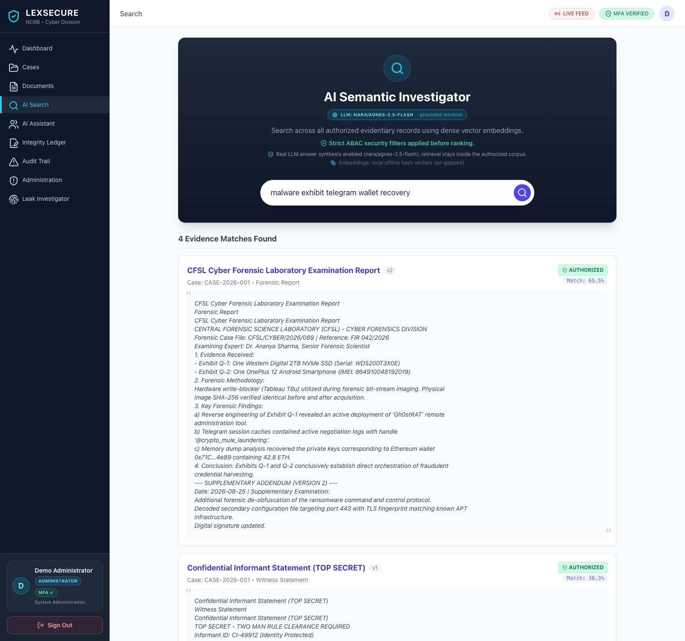

| Element | Meaning |
|---|---|
| **LLM: provider/model** badge | Which model is configured. If the provider fails, the app says so and answers from the local template instead. |
| **Strict ABAC security filters applied before ranking** | Not a slogan — the filter runs before similarity scoring, so unauthorized chunks are never ranked and never sent to a model. |
| Search field | Plain-language query |
| **Match: 42.3%** | Similarity score for that chunk |
| **AUTHORIZED** | The chunk passed your clearance |
| Result excerpt | The matched text, quoted from the source |

---

## AI Assistant

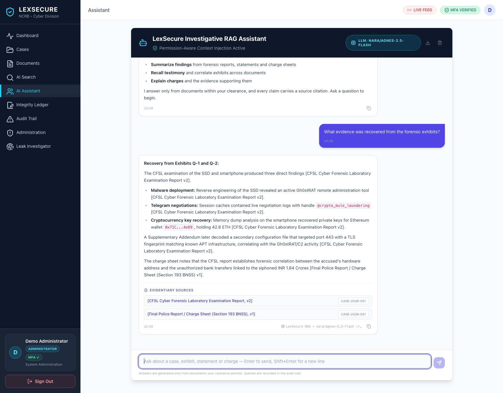

| Element | Meaning |
|---|---|
| **Permission-Aware Context Injection Active** | Only chunks you are cleared to read are placed into the model's context |
| **LLM: provider/model** badge | The live model, and whether it is degraded |
| Download / delete icons | Export the transcript, or clear the conversation |
| Message bubble (blue) | Your question |
| Answer bubble (white) | The generated answer, with inline `[Document Title vN]` citations |
| **Evidentiary Sources** | The exact documents the answer was drawn from, each with its case |
| `LexSecure RAG + provider/model` | The attribution line under each answer |
| Composer | Type and press **Enter** to send, **Shift+Enter** for a new line |

> When the provider is unreachable the answer falls back to a deterministic
> template and the footer says so explicitly. A template answer is never
> presented as model output.

---

## Audit Trail

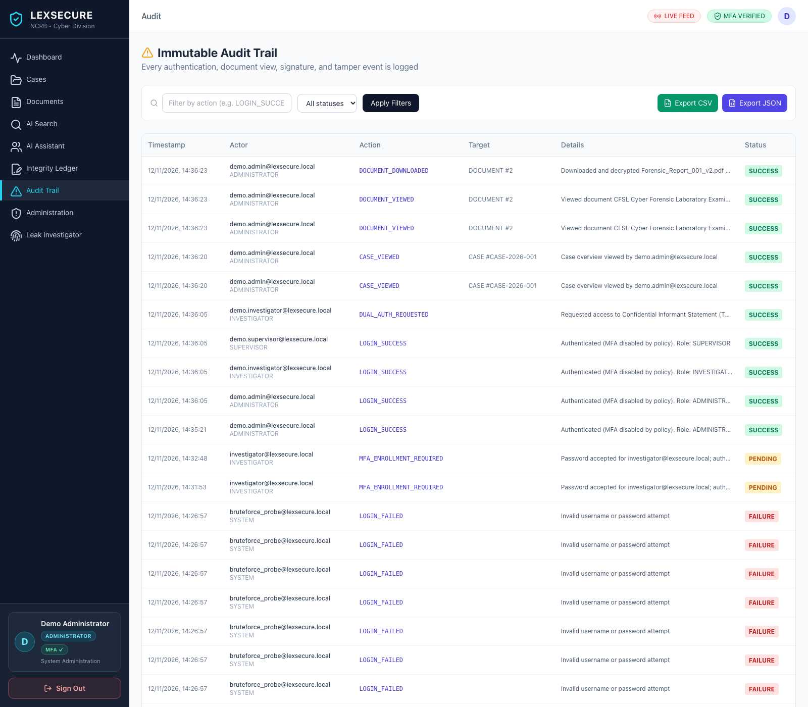

| Element | Meaning |
|---|---|
| Action filter | e.g. `LOGIN_SUCCESS`, `DOCUMENT_SIGNED`, `TAMPER_ALERT` |
| Status filter | `SUCCESS` / `FAILURE` / `WARNING` / `BLOCKED` |
| **Export CSV / Export JSON** | Downloads the filtered trail. The response carries an `X-Export-SHA256` header attesting to the exact bytes shipped, and the export is itself recorded in the trail. |
| Timestamp | UTC |
| Actor | Email and role of who did it |
| Action | The event name |
| Target | What it happened to |
| Details | Human-readable detail |
| Status chip | Green = success, red = failure or blocked, amber = warning |

Non-supervisors see only their own events. Supervisors and Administrators see
everything.

---

## Administration

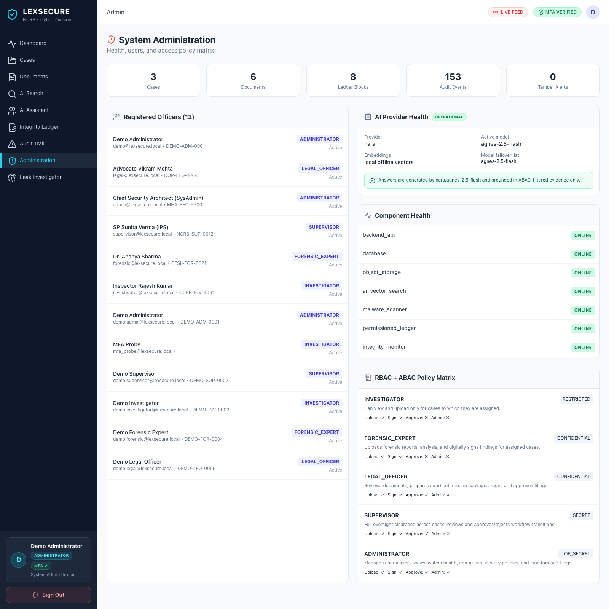

| Element | Meaning |
|---|---|
| Metric cards | Cases, Documents, Ledger Blocks, Audit Events, Tamper Alerts |
| **Registered Officers** | The account directory. *Administrators only* — a Supervisor sees an explicit notice instead, because the API answers 403. |
| **Active / Deactivated** | Whether the account can sign in |
| **AI Provider Health** | The live provider, active model, embedding mode and the failover list. `OPERATIONAL` / `DEGRADED` if the last call failed. |
| **Component Health** | Every subsystem: backend, database, storage, vector index, scanner, ledger, monitor |
| **RBAC + ABAC Policy Matrix** | The rule set for each role: clearance level, what they can view/upload/sign/approve/admin, and the rule in plain language |

---

## Leak Investigator

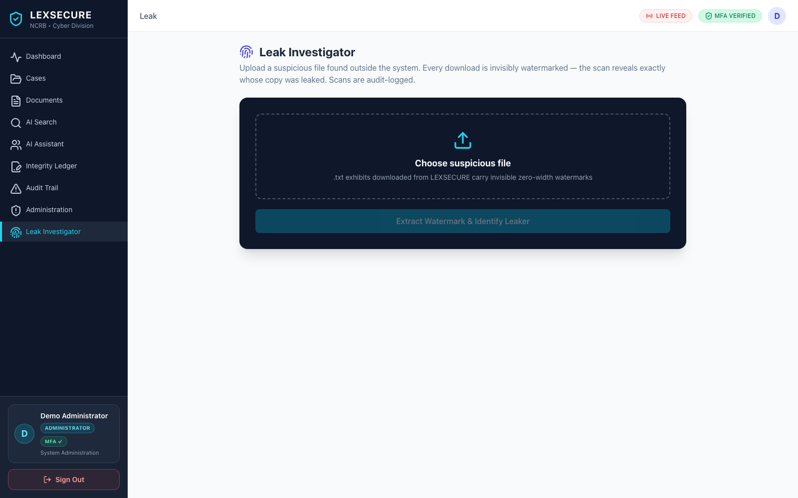

| Element | Meaning |
|---|---|
| Drop zone | Upload a suspicious file found outside the system |
| **Extract Watermark & Identify Leaker** | Scans for the invisible frame and reports the officer whose download it came from |
| Result panel | The email, user id, document id, version and exact download timestamp of every watermark found — a leaked file can accumulate several |
| Custody chain | If the file passed through several people, each holder is listed in order |

Only text documents are watermarked. Binary formats (PDF, PNG) are streamed
untouched, so they cannot be traced this way.

---

## Two-Man Rule

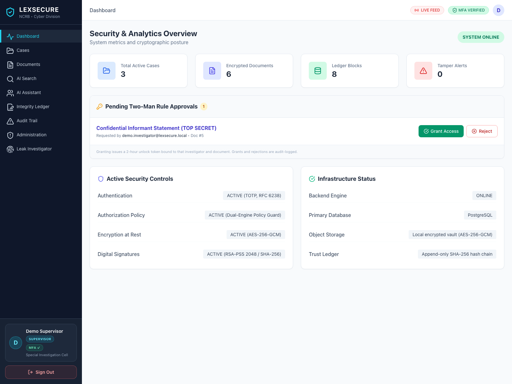

| Element | Meaning |
|---|---|
| Pending row | A sealed document an officer asked to open |
| **Grant Access** | Issues a 2-hour unlock token bound to that officer and that document. The officer's page unlocks automatically. |
| **Reject** | Denies it. The officer can request again. |
| On the requester's screen | A locked panel showing **Request Supervisor Access**, then *Pending*, then *Access Granted* with a live countdown. Expired or wrong tokens fail closed with 403. |

---

## Access denied

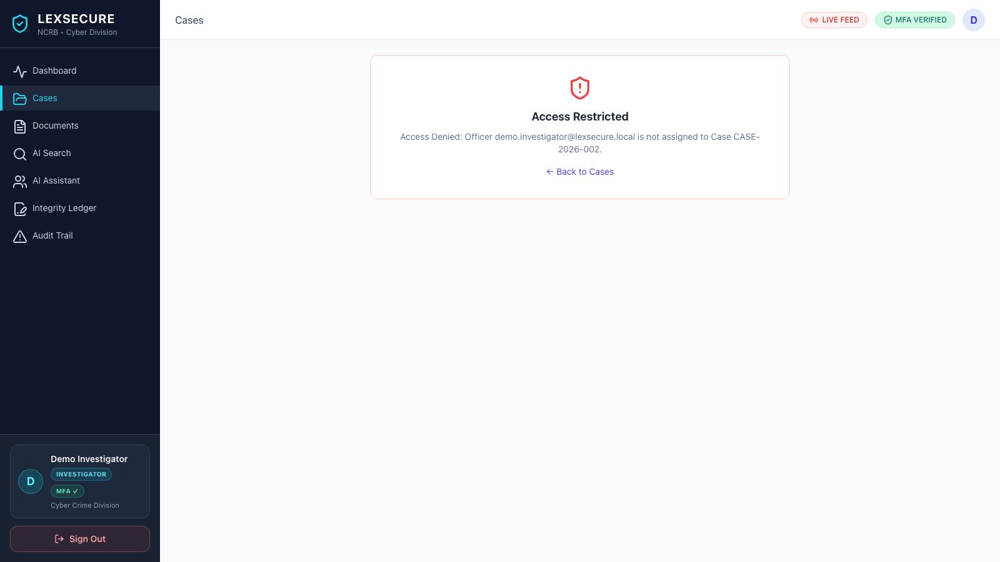

| Element | Meaning |
|---|---|
| **Access Restricted** | You are signed in but not cleared for this case |
| The message | Names you and the case: *"Officer … is not assigned to Case …"* |
| **← Back to Cases** | Returns to the list |

The attempt is recorded in the audit trail as `UNAUTHORIZED_ACCESS` with
status `BLOCKED`.

---

## Profile menu

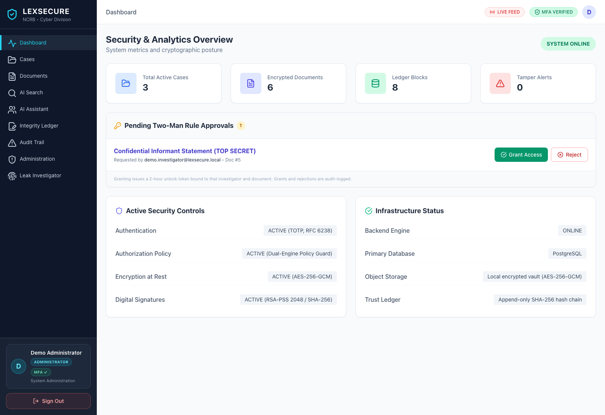

| Element | Meaning |
|---|---|
| Name, role | Who you are |
| Email | Your account |
| Department | Your division |
| Badge No. | Your official identifier |
| **MFA** | `Verified this session` or `Enabled` / `Disabled` |
| **Assigned Cases (n)** | The cases you are cleared for |
| **Sign Out** | Ends the session and revokes the token |
